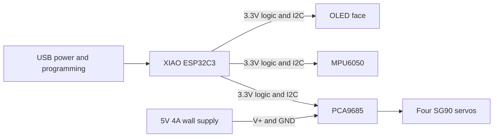

# Desktop Companion Robot

Wiring reference: [full pinout atlas and verification limits](docs/wiring/README.md). Use the stage matching your lesson; do not connect every pictured module at once.
<!-- wiring:start -->
**Parts for this power checkpoint:** a regulated 5V wall supply, its low-voltage connector and prepared wires, and a multimeter. For the motor connection, also identify the SG90 servo and PCA9685 driver. The supply powers the motor through the driver; the meter checks its output before connection. Identify these parts before following the diagram.

### Wiring visuals and pinouts

**Before assembling these connections: close the monitor and unplug the XIAO USB cable. Keep the newly introduced 5V supply unplugged from the wall until the voltage-check step. On a repeat session, unplug it before changing wires.** These are functional illustrations: locate terminals by their printed labels. Board shapes do not establish physical pin positions.


The pinout for this stage is USB-C socket only: **all XIAO header pins are unused**.

| From / pin | To / pin | Meaning |
|---|---|---|
| Computer USB port | XIAO USB-C socket | Data cable; all headers empty |


Functional pinout: VCC, GND, SDA, SCL. The supplied display photo has **GND / VCC / SCL / SDA** across its top header when viewed from the front. Our illustration groups wires by function, not that physical order.

| From / pin | To / pin | Meaning |
|---|---|---|
| XIAO 3V3 | AITRIP SSD1306 OLED VCC | 3.3V logic |
| XIAO GND | AITRIP SSD1306 OLED GND | Shared ground |
| XIAO D4 / GPIO6 | AITRIP SSD1306 OLED SDA | I2C data |
| XIAO D5 / GPIO7 | AITRIP SSD1306 OLED SCL | I2C clock |


Functional pinout: VCC, GND, SCL, SDA, XDA, XCL, AD0, INT. Leave XDA/XCL/INT open; verify AD0 default through scanning. Exact delivered header order is unconfirmed. Check regulator/pull-ups at 3.3V; do not substitute 5V to fix detection.

| From / pin | To / pin | Meaning |
|---|---|---|
| XIAO 3V3 | GY-521 / MPU6050 VCC | 3.3V logic |
| XIAO GND | GY-521 / MPU6050 GND | Shared ground |
| XIAO D4 / GPIO6 | GY-521 / MPU6050 SDA | I2C data |
| XIAO D5 / GPIO7 | GY-521 / MPU6050 SCL | I2C clock |


The green two-screw block is a separate power input: one terminal is + / V+, the other is - / GND. It stays empty during this communication-only test; the driver electronics receive power through VCC. Follow the board markings, not a guessed left/right position. Functional pinout: VCC = logic 3.3V; V+ = separate output-power input; GND = common ground; SDA/SCL = I2C; OE = active-low output enable. Exact clone header order is unconfirmed. Verify OE pull-down; ground OE only if floating. Use only VCC, GND, SDA and SCL for this communication test. Leave V+ and the numbered output connectors empty.

| From / pin | To / pin | Meaning |
|---|---|---|
| XIAO 3V3 | Teyleten PCA9685 VCC | 3.3V logic |
| XIAO GND | Teyleten PCA9685 GND | Shared ground |
| XIAO D4 / GPIO6 | Teyleten PCA9685 SDA | I2C data |
| XIAO D5 / GPIO7 | Teyleten PCA9685 SCL | I2C clock |


**Identify the green two-screw block on the PCA9685:** its + / V+ terminal accepts the regulated 5V supply positive wire; its - / GND terminal accepts the negative wire. They are not both V+. This block is not VCC, and it is different from the separate barrel-to-terminal connector on the supply cable. Confirm the actual board markings with power unplugged; the illustration does not establish left/right orientation. Functional servo pinout: ground, power, signal. Read the driver row labels before inserting the plug. **Keep all four XIAO logic wires connected**, as shown in this complete diagram: 3V3/VCC, GND/GND, D4/SDA and D5/SCL. The shared-ground wire is one of these four wires, not an extra fifth wire. Use only channel 0 for this experiment. USB and adapter grounds meet at PCA GND; adapter positive never meets XIAO 5V or 3V3. Grounded OE is not a reset interlock: unplug servo power for uploads, resets and horn fitting.

| From / pin | To / pin | Meaning |
|---|---|---|
| Adapter positive | PCA green block: + / V+ | Regulated 5V; direct power wire |
| Adapter negative | PCA green block: - / GND | Direct power wire |
| XIAO 3V3 | PCA VCC | Logic power, separate from V+ |
| XIAO GND | PCA GND | Common reference |
| XIAO D4 / GPIO6 | PCA SDA | I2C data |
| XIAO D5 / GPIO7 | PCA SCL | I2C clock |
| PCA channel 0 GND | SG90 ground | Usually brown/black; verify |
| PCA channel 0 V+ | SG90 power | Usually red; verify |
| PCA channel 0 PWM | SG90 signal | Usually orange/yellow; verify |

<!-- wiring:end -->

A personal, solder-free desktop robot inspired by Nickson Kiprotich's TN-24: an OLED face, four expressive legs, and motion sensing. Build a corded V1 first, then develop a cordless V2.

**Status: first bench firmware and printable fit gauges available; no physical hardware or print tests yet.** This is an early build in progress, not a completed robot kit. Full body/leg CAD and walking behavior remain pending.

## Learn together

**New to robotics? Start with [the beginner guide](docs/START-HERE.md), then follow [the hands-on lessons](lessons/README.md).** No previous coding experience is assumed. Work with an adult, predict what will happen, test one thing, and record the result.

Read [Andrew and the Tiny Robot with Big Ideas](docs/book/README.md) alongside the experiments. The book's first edition describes an Arduino IDE path; the current repository also provides a complete Windows terminal path. Codex and Arduino IDE are optional interfaces, not prerequisites for the terminal lessons.

## Run from this repository

From PowerShell in this folder, on Windows x64:

```powershell
.\robot.ps1 setup
.\robot.ps1 build -Sketch Hello
.\robot.ps1 ports
```

Setup downloads pinned tools into this checkout's ignored `.tools/` folder. No author-specific paths or global Arduino CLI installation are required. These three commands do not upload or move hardware. If your board may already be programmed, [inspect it first](docs/COMMANDS.md#check-an-existing-program).

- [Setup and prerequisites](docs/SETUP.md)
- [Command reference](docs/COMMANDS.md)
- [Troubleshooting](docs/TROUBLESHOOTING.md)
- [Codex teaching workflow](docs/CODEX-WORKFLOW.md)
- [Experiment template](templates/EXPERIMENT.md) and [contribution process](CONTRIBUTING.md)
- [Reproduce the book and CAD](docs/REPRODUCE.md)

The repository is currently private; new users need GitHub access or an authorized copy. Tool binaries are downloaded, not committed. The final printable body and legs are still unfinished; this is a teaching project in development.

## Build something now

- All additional V1 parts are reported in hand. Begin with checks rather than more electronics purchases.
- Start with [First power-on](docs/FIRST-POWER-ON.md): upload the bench firmware, check the OLED and motion sensor, then calibrate one unloaded servo.
- Print the [two fit gauges](cad/README.md) to check your hardware dimensions before printing a complete body.
- Record `status` / `scan` output and fit results so the next enclosure revision can match the actual parts.

## Start here

1. Review the [Amazon shopping list](docs/SHOPPING-LIST.md) before ordering.
2. Follow the [staged build instructions](docs/BUILD.md) and the new first-power-on guide. Full enclosure assembly remains a later stage.
3. Use the [wiring specification](docs/WIRING.md) and [measurement sheet](docs/MEASUREMENTS.md).
4. Track progress against the [V1/V2 plan](docs/PLAN.md) and record results in the [test log](docs/TEST-LOG.md).
5. See the [upstream study and sources](docs/UPSTREAM.md) for what exists in TN-24 and what we need to implement.

## Is the shopping list complete?

**Bench electronics and tools: selected, with receipt checks. Full physical robot: not yet.**

The remaining procurement decisions are filament, enclosure screws/nuts and retention hardware after CAD, and a USB power source if the robot must operate away from a computer. The selected adapter's picture shows a screw-terminal accessory, but its written package list is ambiguous; verify it arrives. Do not buy duplicate electronics already owned.

## Design requirements

| Area | V1 decision |
|---|---|
| Assembly | No user soldering; installed headers, plug-in cables, screw terminals |
| Controller | Pre-soldered Seeed XIAO ESP32C3 |
| Face | AITRIP 0.96-inch SSD1306, 128 x 64, I2C |
| Movement | Four SG90 positional servos through a PCA9685 board |
| Sensing | Pre-soldered GY-521 MPU6050 |
| Power | USB for controller; separate regulated 5V/4A supply for servos; shared ground |
| Printing | Bambu Lab A1; editable source CAD and STL exports planned |
| Purchasing | Amazon only |
| V2 | Cordless, with a newly qualified battery/charger/regulator system |

V1 has **two power leads during development**. A one-cord arrangement is not yet designed. The controller remains usable for later Wi-Fi features; camera or voice AI is outside V1.



All modules share ground. The servo supply does not feed the XIAO's 5V or 3V3 pins in this arrangement.

## Repository layout

- `docs/`: shopping, wiring, assembly, measurement, validation, and roadmap.
- `firmware/`: bench diagnostics, calibration, animated face and a small gesture demo.
- `cad/`: editable fit gauges and STL exports; full robot models are pending.
- `scripts/`: repeatable firmware build and STL validation.
- `lessons/`: standalone introductory sketches and guided experiments.
- `robot.ps1` and `toolchain.psd1`: one command entry point and pinned dependencies.
- `templates/`: experiment records; keep personal drafts in ignored `notes/`.

## Development approach

Work on short feature branches and preserve a tested baseline. Separate display, sensing, servo calibration, behavior, and configuration. Every physical revision needs a documented fit test; every firmware release needs recorded board/library versions and a reproducible build command. Tag a V1 release only after the acceptance checklist passes.

## Attribution and reuse

Inspired by [tech-nickk/TN24](https://github.com/tech-nickk/TN24) and the [TN-24 V2 article](https://www.electromaker.io/project/view/tn-24-v20-cute-desktop-companion-robot). This is an independent personal project, not an official TN-24 release. No upstream source or product imagery is copied into this repository. No project-wide reuse license has been selected; decide that before a public release. The article's license label and the repository's missing license file are recorded in the upstream study.
