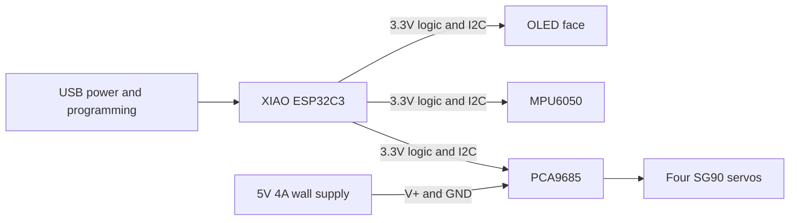

# Desktop Companion Robot

A personal, solder-free desktop robot inspired by Nickson Kiprotich's TN-24: an OLED face, four expressive legs, and motion sensing. Build a corded V1 first, then develop a cordless V2.

**Status: planning and procurement. No working firmware, CAD, STLs, or hardware test results are included yet.** This repository is a build specification and development plan, not a completed robot kit.

## Start here

1. Review the [Amazon shopping list](docs/SHOPPING-LIST.md) before ordering.
2. Follow the [staged build instructions](docs/BUILD.md). Stop at stages requiring unreleased firmware or CAD.
3. Use the [wiring specification](docs/WIRING.md) and [measurement sheet](docs/MEASUREMENTS.md).
4. Track progress against the [V1/V2 plan](docs/PLAN.md) and record results in the [test log](docs/TEST-LOG.md).
5. See the [upstream study and sources](docs/UPSTREAM.md) for what exists in TN-24 and what we need to implement.

## Is the shopping list complete?

**Bench electronics and tools: selected, with receipt checks. Full physical robot: not yet.**

The remaining procurement decisions are filament, enclosure screws/nuts and retention hardware after CAD, and a USB power source if the robot must operate away from a computer. The selected adapter's picture shows a screw-terminal accessory, but its written package list is ambiguous; verify it arrives. Do not buy duplicate electronics already owned.

## Design requirements

| Area | V1 decision |
|---|---|
| Assembly | No user soldering; installed headers, plug-in cables, screw terminals |
| Controller | Pre-soldered Seeed XIAO ESP32C3 |
| Face | AITRIP 0.96-inch SSD1306, 128 x 64, I2C |
| Movement | Four SG90 positional servos through a PCA9685 board |
| Sensing | Pre-soldered GY-521 MPU6050 |
| Power | USB for controller; separate regulated 5V/4A supply for servos; shared ground |
| Printing | Bambu Lab A1; editable source CAD and STL exports planned |
| Purchasing | Amazon only |
| V2 | Cordless, with a newly qualified battery/charger/regulator system |

V1 has **two power leads during development**. A one-cord arrangement is not yet designed. The controller remains usable for later Wi-Fi features; camera or voice AI is outside V1.

All modules share ground. The servo supply does not feed the XIAO's 5V or 3V3 pins in this arrangement.

## Repository layout

- `docs/`: shopping, wiring, assembly, measurement, validation, and roadmap.
- `firmware/`: future diagnostic sketches and robot firmware.
- `cad/`: future editable models, fit samples, and STL exports.

## Development approach

Work on short feature branches and preserve a tested baseline. Separate display, sensing, servo calibration, behavior, and configuration. Every physical revision needs a documented fit test; every firmware release needs recorded board/library versions and a reproducible build command. Tag a V1 release only after the acceptance checklist passes.

## Attribution and reuse

Inspired by [tech-nickk/TN24](https://github.com/tech-nickk/TN24) and the [TN-24 V2 article](https://www.electromaker.io/project/view/tn-24-v20-cute-desktop-companion-robot). This is an independent personal project, not an official TN-24 release. No upstream source or product imagery is copied into this repository. No project-wide reuse license has been selected; decide that before a public release. The article's license label and the repository's missing license file are recorded in the upstream study.
