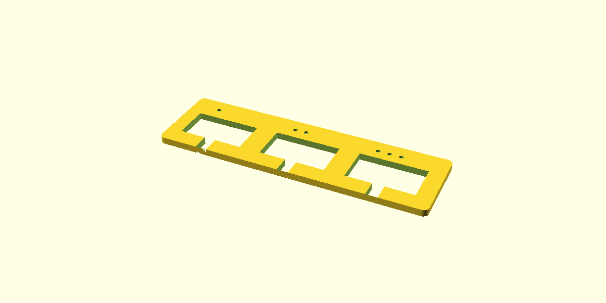

# CAD workspace

Original fit gauges are available now. **These are measurement samples, not the final enclosure or structural servo mounts.** The owner has tested the two-dot opening and reported loose V2 retention. V4 screw retention is not physically tested yet.

| File | Purpose | Overall dimensions |
|---|---|---|
| [servo-fit-gauge.stl](stl/servo-fit-gauge.stl) | Compare three servo-body clearances | 94 x 28 x 2.4mm |
| [oled-fit-gauge.stl](stl/oled-fit-gauge.stl) | Check PCB outline clearance with open header edge | 32 x 32.3 x 2.4mm |
| [fit-tests.scad](fit-tests.scad) | Editable OpenSCAD source for both | Parameters in millimeters |



## Print and measure

1. Import STL into Bambu Studio, select your A1 and actual nozzle. Use **100% scale** and verify displayed dimensions.
2. For a standard 0.4mm nozzle and PLA, start with 0.20mm layers and 3 walls. Lay flat as exported; supports should not be needed. These are provisional settings; assess the sliced preview before printing.
3. With power off, pass the servo cable through a notch and gently try the servo body in each opening. Do not force it. The ears stay above the gauge.
4. One dimple marks a 22.6 x 12.5mm aperture, two mark 23.0 x 12.9mm, and three mark 23.4 x 13.3mm. Report which is snug without squeezing. The notches are cable escape gaps, not final cable channels.
5. The OLED gauge's opening is 28.0 x 28.3mm, based on an unmeasured nominal PCB. Hold the module by its PCB and compare the outline. It has no retaining lip: **support the module so it cannot fall through**. Do not press the display glass. A too-small opening is useful measurement feedback, not a reason to force insertion.
6. Record fit, measured board sizes and photos in the measurement sheet. The visible-screen window, screw holes and final mounts are still to be designed.

## Reproduce exports

OpenSCAD 2021.01 was used. From repository root:

```powershell
openscad -o cad/stl/servo-fit-gauge.stl -D 'part="servo"' cad/fit-tests.scad
openscad -o cad/stl/oled-fit-gauge.stl -D 'part="oled"' cad/fit-tests.scad
python scripts/validate_meshes.py
```

The mesh check verifies closed edges, winding, one connected shell, positive volume and expected bounds. It does not verify real-world dimensions, part fit, print strength or printer output. Update expected bounds if deliberately changing the source dimensions.

Next: use [actual measurements](../docs/MEASUREMENTS.md) and gauge results to create the servo cradle, OLED mount, lightweight chassis, legs, removable shell and power-cord strain relief. Final fasteners and STLs await those checks.

Servo openings use your Amazon WWZMDiB SG90 listing, with three clearance choices. See [dimension sources and the seller drawing discrepancy](SERVO-DIMENSIONS.md). Use the regenerated STL; an earlier copy used generic SG90 dimensions.

## First servo cradle

The owner reports the two-dot gauge opening fits best. [Print and check one cradle](../docs/BUILD-CHECKPOINT-02.md), using that opening and adjustable mounting slots. [STL](stl/servo-cradle-v1.stl) / [editable source](servo-cradle-v1.scad). This is an untested fit prototype, not yet a load-bearing robot mount.

## Historical prototype: screw-free V2

Use [checkpoint 3](../docs/BUILD-CHECKPOINT-03.md) and [V2 STL](stl/servo-cradle-v2.stl). It replaces V1 for the next fit test: side-entry cable channel and four releaseable snap tabs. V1 remains as design history; its closed opening obstructed the side cable during installation. V2 retention and durability are unverified.

## Historical revision: V3 retention adjustment

The owner reports loose V2 hooks. Use [V3 STL](stl/servo-cradle-v3.stl) and [updated checkpoint 3](../docs/BUILD-CHECKPOINT-03.md). Each hook reaches 1.0mm farther inward and sits 0.2mm lower; body opening and cable channel are unchanged. This remains an unverified fit prototype. V1/V2 are retained for comparison.

## Current prototype: V4 screw retention

Use [checkpoint 4](../docs/BUILD-CHECKPOINT-04.md) and [V4 STL](stl/servo-cradle-v4.stl). Two M2 x 10mm screws, two M2 nuts and four flat washers retain the servo. The 44 x 30 x 4mm plate preserves the proven opening and moves cable entry to the long side to keep both screw supports intact. V1–V3 are design history; do not print snap-tab versions for the next checkpoint. Physical validation remains pending.

## Current: Leg V1 and single-leg stand

Use [checkpoint 5](../docs/BUILD-CHECKPOINT-05.md). [Leg STL](stl/leg-v1.stl) (14 x 70 x 8mm) has a pocket for the SG90 double-arm horn, sized from the 33mm listing length with 0.6mm clearance, a 5.5mm screwdriver hole over the shaft screw, and 6mm of plastic under the horn for the horn screws. [Stand STL](stl/leg-stand-v1.stl) (80 x 60 x 58mm) holds a V4 mount upright by its continuous long edge so the shaft sits about 65mm above the table. Source: [leg-v1.scad](leg-v1.scad), `part="leg"` or `part="stand"`. Horn hub and tip widths are assumptions, not measurements. No print, fit or motion test yet.

## Leg V2 (replaces Leg V1)

Leg V1 was printed by the owner and did not fit the horn. [Leg V2](stl/leg-v2.stl) (13 x 70 x 5mm, [source](leg-v2.scad)) follows the owner's horn as measured from grid-sheet photos: about 35.7mm long, with a 7.2mm spline boss and a raised 8.7mm disc on the screw side. The horn's flat side goes into the pocket. An M2 x 6 screw through the leg and horn into the shaft clamps it. A [horn gauge](stl/horn-gauge.stl) and [measuring sheet](../docs/measure/README.md) support re-measuring. Not yet printed.

## Leg V3 (replaces Leg V2)

Andrew noticed from close-up photos that the horn's screw side is a straight-sided disc (about 8.0-8.7mm across, about 1.1mm tall) with small ramps where it joins the arm; from the side the ramps make it look sloped. [Leg V3](stl/leg-v3.stl) (13 x 70 x 5.3mm, [source](leg-v3.scad)) has a 9.4mm round recess 1.3mm deep for the disc, plus a sloped clearance (9.4mm at the bottom to 13.4mm at the arm face, trimmed to the arm pocket) for the ramps. V2's recess was only 1.0mm deep. The leg is 0.3mm thicker to keep 2mm of plastic under the hub. Owner's printed gauge: arm 2.0mm, spline boss 7.5mm. Not yet printed.

## Leg V4 (replaces Leg V3)

The owner printed V3: the horn would not go in and the screw holes were too small. [Leg V4](stl/leg-v4.stl) (14 x 70 x 5.8mm, [source](leg-v4.scad)) keeps the V3 layout with more clearance: 0.5mm per side around the horn arms (was 0.2), a 10.0mm x 1.5mm disc recess (was 9.4 x 1.3), a 2.2mm pocket (was 2.0), a 2.9mm shaft-screw hole (was 2.4) and 1.6mm pilot holes (was 1.0). The leg is wider and thicker to keep 2mm walls and floor. Not yet printed.

## Leg V5 (replaces Leg V4)

Owner's screw plan: the servo's own centre screw holds the horn on the shaft, and two M2 x 4 screws go down through the leg into the horn's 4th arm holes (13.4mm from centre), cutting their own thread in the horn plastic. [Leg V5](stl/leg-v5.stl) (14 x 70 x 5.8mm, [source](leg-v5.scad)) keeps V4's clearances, replaces the centre hole with a 5.5mm screwdriver hole, and adds two 2.6mm side holes with 4.4mm x 1.2mm head recesses on the outside face. Not yet printed.

## Leg V6 (replaces Leg V5) — current

Owner found that the servo bag has the right screws: two large pointed self-tapping screws (about 2.2mm thread, 7mm shank, 4.7mm flanged head) and one small screw (about 2.0mm thread, 3.5mm shank, 2.8mm head), measured from grid-sheet photos. [Leg V6](stl/leg-v6.stl) (14 x 70 x 8.5mm, [source](leg-v6.scad)): the large screws go up through the horn's 4th arm holes (13.4mm from centre) into 2.0mm blind pilot holes 5.6mm deep; the small screw holds the horn on the shaft, reached through a 6.0mm centre hole. Keeps V4 clearances (0.5mm per side, 10.0 x 1.5mm disc recess, 2.2mm pocket). The leg is 8.5mm thick so the 7mm screws stay blind. The large screw heads sit under the horn: their clearance to the servo case through the swing is not verified. Not yet printed.
