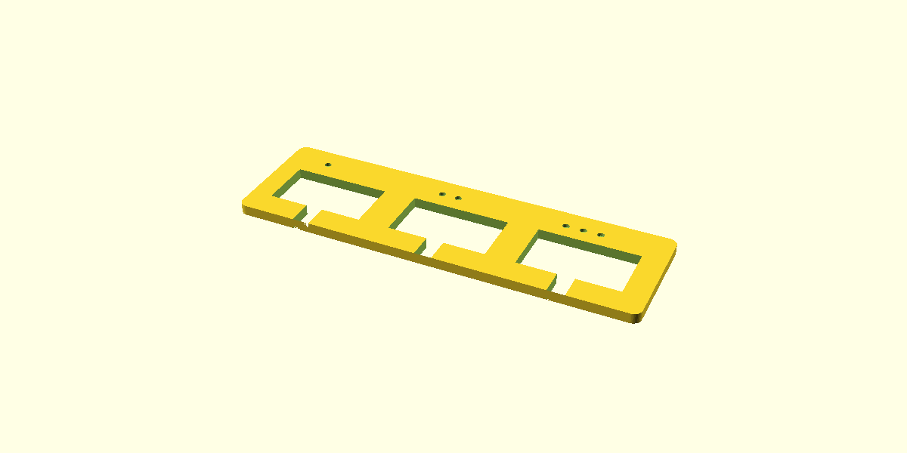

# CAD workspace

Original fit gauges are available now. **These are measurement samples, not the final enclosure or structural servo mounts.** The owner has tested the two-dot opening and reported loose V2 retention. V4 screw retention is not physically tested yet.

| File | Purpose | Overall dimensions |
|---|---|---|
| [servo-fit-gauge.stl](stl/servo-fit-gauge.stl) | Compare three servo-body clearances | 94 x 28 x 2.4mm |
| [oled-fit-gauge.stl](stl/oled-fit-gauge.stl) | Check PCB outline clearance with open header edge | 32 x 32.3 x 2.4mm |
| [fit-tests.scad](fit-tests.scad) | Editable OpenSCAD source for both | Parameters in millimeters |



## Print and measure

1. Import STL into Bambu Studio, select your A1 and actual nozzle. Use **100% scale** and verify displayed dimensions.
2. For a standard 0.4mm nozzle and PLA, start with 0.20mm layers and 3 walls. Lay flat as exported; supports should not be needed. These are provisional settings; assess the sliced preview before printing.
3. With power off, pass the servo cable through a notch and gently try the servo body in each opening. Do not force it. The ears stay above the gauge.
4. One dimple marks a 22.6 x 12.5mm aperture, two mark 23.0 x 12.9mm, and three mark 23.4 x 13.3mm. Report which is snug without squeezing. The notches are cable escape gaps, not final cable channels.
5. The OLED gauge's opening is 28.0 x 28.3mm, based on an unmeasured nominal PCB. Hold the module by its PCB and compare the outline. It has no retaining lip: **support the module so it cannot fall through**. Do not press the display glass. A too-small opening is useful measurement feedback, not a reason to force insertion.
6. Record fit, measured board sizes and photos in the measurement sheet. The visible-screen window, screw holes and final mounts are still to be designed.

## Reproduce exports

OpenSCAD 2021.01 was used. From repository root:

```powershell
openscad -o cad/stl/servo-fit-gauge.stl -D 'part="servo"' cad/fit-tests.scad
openscad -o cad/stl/oled-fit-gauge.stl -D 'part="oled"' cad/fit-tests.scad
python scripts/validate_meshes.py
```

The mesh check verifies closed edges, winding, one connected shell, positive volume and expected bounds. It does not verify real-world dimensions, part fit, print strength or printer output. Update expected bounds if deliberately changing the source dimensions.

Next: use [actual measurements](../docs/MEASUREMENTS.md) and gauge results to create the servo cradle, OLED mount, lightweight chassis, legs, removable shell and power-cord strain relief. Final fasteners and STLs await those checks.

Servo openings use your Amazon WWZMDiB SG90 listing, with three clearance choices. See [dimension sources and the seller drawing discrepancy](SERVO-DIMENSIONS.md). Use the regenerated STL; an earlier copy used generic SG90 dimensions.

## First servo cradle

The owner reports the two-dot gauge opening fits best. [Print and check one cradle](../docs/BUILD-CHECKPOINT-02.md), using that opening and adjustable mounting slots. [STL](stl/servo-cradle-v1.stl) / [editable source](servo-cradle-v1.scad). This is an untested fit prototype, not yet a load-bearing robot mount.

## Historical prototype: screw-free V2

Use [checkpoint 3](../docs/BUILD-CHECKPOINT-03.md) and [V2 STL](stl/servo-cradle-v2.stl). It replaces V1 for the next fit test: side-entry cable channel and four releaseable snap tabs. V1 remains as design history; its closed opening obstructed the side cable during installation. V2 retention and durability are unverified.

## Historical revision: V3 retention adjustment

The owner reports loose V2 hooks. Use [V3 STL](stl/servo-cradle-v3.stl) and [updated checkpoint 3](../docs/BUILD-CHECKPOINT-03.md). Each hook reaches 1.0mm farther inward and sits 0.2mm lower; body opening and cable channel are unchanged. This remains an unverified fit prototype. V1/V2 are retained for comparison.

## Current prototype: V4 screw retention

Use [checkpoint 4](../docs/BUILD-CHECKPOINT-04.md) and [V4 STL](stl/servo-cradle-v4.stl). Two M2 x 10mm screws, two M2 nuts and four flat washers retain the servo. The 44 x 30 x 4mm plate preserves the proven opening and moves cable entry to the long side to keep both screw supports intact. V1–V3 are design history; do not print snap-tab versions for the next checkpoint. Physical validation remains pending.
