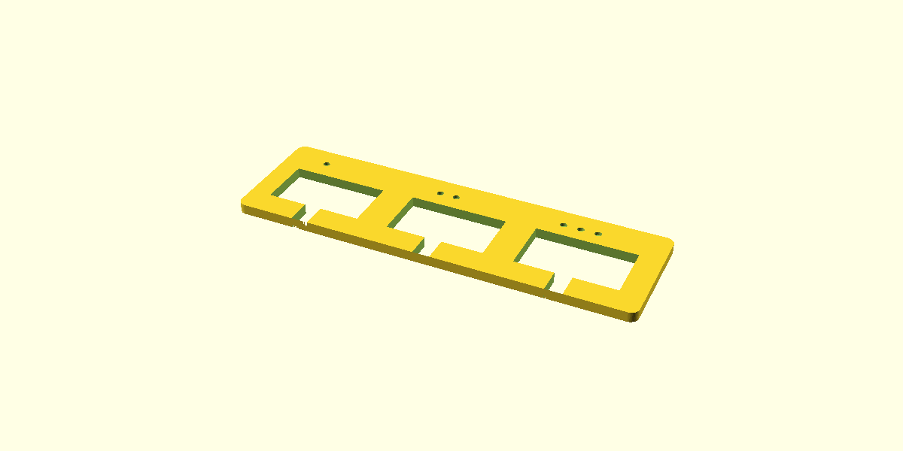

# Build checkpoint 1: find the fit

## Mission
Make a tiny test print that helps us build a good home for one servo. A servo is the little motor you already tested. Its mount must hold the plastic case without squeezing it.

## Start here
You finished the seven electronics lessons. Keep the working electronics layout for later. This checkpoint needs no upload and no powered movement. Use a spare, unconnected servo if you have one. Before handling the connected setup, unplug its motor supply and USB.

Get one servo, the printer, and your filament. Keep the servo horn and its little screws in a container; do not attach a leg yet.

## Predict
Which opening will fit best: the smallest, middle, or largest? Tell your teammate before trying it.

## Do this
1. Open [servo-fit-gauge.stl](../cad/stl/servo-fit-gauge.stl) in Bambu Studio.
2. Select your actual printer, nozzle and filament. Keep scale at **100%**. The part should measure **94 x 28 x 2.4 mm**.
3. For PLA with a 0.4 mm nozzle, use 0.20 mm layers and 3 walls as the starting settings. Keep the plate flat. Check the sliced preview; this flat gauge should not need supports. If your nozzle or material differs, use its matching profile rather than copying those settings blindly.
4. Print only this gauge. Let it cool before removing it.
5. Find the one, two and three little dimples. They identify the three openings.
6. With the servo unpowered, guide its cable through the open notch. Gently try its plastic body in each opening. The mounting ears stay above the plate. **Do not force it.**
7. Pick the opening that lets the body slide in without squeezing, with the least wobble. If none works, report that; it is useful information.



## What the dimples mean
| Dimples | Opening length x width |
|---|---|
| 1 | 22.6 x 12.5 mm |
| 2 | 23.0 x 12.9 mm |
| 3 | 23.4 x 13.3 mm |

This is a measuring sample, not a mount or a leg. It does not check screw positions, case height or shaft clearance.

## Tell us the result
Copy and fill this in:

```text
Printer / nozzle:
Filament:
One dimple: too tight / good fit / loose
Two dimples: too tight / good fit / loose
Three dimples: too tight / good fit / loose
Best fit:
```

A photo with the servo in the best opening helps. If the print is warped or the dimensions differ from the slicer, report that before choosing a fit.

## Finish line
Success means we know which opening fits, or how the gauge needs to change. We do not need a perfect first print.

Next checkpoint: measure the mounting ears and shaft location, then design one cradle using your fit result. We will do that after this check, not guess those dimensions now. The wide bench sweep is not a movement limit for a leg attached to a servo.

Servo openings use your Amazon WWZMDiB SG90 listing, with three clearance choices. See [dimension sources and the seller drawing discrepancy](../cad/SERVO-DIMENSIONS.md). Use the regenerated STL; an earlier copy used generic SG90 dimensions.
