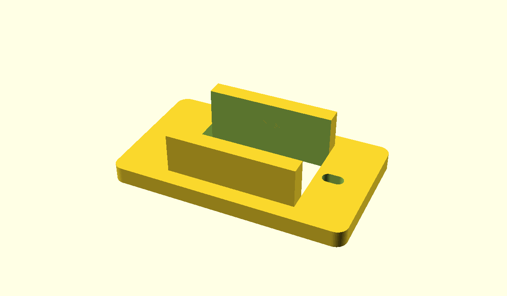

# Build checkpoint 2: a home for one motor

**Superseded for printing:** the side cable obstructed V1 installation. Use [the screw-free V2 checkpoint](BUILD-CHECKPOINT-03.md) instead. This page preserves the first experiment.

## Mission
Print one cradle and check whether your motor sits comfortably in it. A cradle is the bracket that will hold the motor in the robot. This is a fit prototype; do not attach a leg or run a motor in it yet.

## What we already know
Your two-dot opening fitted best. This cradle keeps that **23.0 x 12.9mm opening**. Two guide walls extend 7mm beneath a 3mm flange. The ends and bottom remain open for cable access. Two elongated screw slots allow adjustment because the seller drawing does not give screw-hole spacing.

## Predict
Will the deeper guide walls fit as easily as the thin gauge? A longer contact surface can reveal a bulge the thin gauge missed.

## Print this
1. Open [servo-cradle-v1.stl](../cad/stl/servo-cradle-v1.stl) in your slicer. Remove the old gauge from the plate.
2. Select your actual printer, nozzle and filament. Keep **100% scale**. Expected size: **42 x 24.9 x 10mm**.
3. Keep the large flat flange on the bed and the two walls pointing up, as exported. For PLA and a 0.4mm nozzle, start with 0.20mm layers and 3 walls. Review the sliced preview; no supports should be needed in this orientation.
4. Print one and let it cool before removal.



## Try the fit
1. Use a spare unconnected servo, or unplug USB and the motor supply before handling your setup.
2. Turn the cradle over so the two walls point down. The smooth bed-facing surface is now the top.
3. Feed the servo cable and plug through the large opening first. If the plug does not pass freely, stop and report it; do not cut or force it.
4. Lower the motor body into the opening. The motor's two mounting ears should rest on the flat flange. The shaft remains above it.
5. Check that the cable is free, the case is not squeezed, and both ear holes overlap the printed slots. Look through the holes; do not install screws yet.
6. Lift the motor out again. A good fit allows removal without prying.

## Tell us three things
- Body: fits / too tight / too loose.
- Both ear holes overlap the slots: yes / no.
- Cable is free and the ears sit flat: yes / no.

A photo of the seated motor helps if anything does not fit. No new measurements are required for this checkpoint.

## What is still provisional
Slots are 2.2mm wide, with center positions adjustable from 13.8 to 15.4mm on either side of the opening center (nominal symmetric hole spacing 27.6–30.8mm). Those are design choices, not measurements of your servo. No screw size, screw length, nut retention, load capacity or mounted travel has been validated. This prototype has no chassis attachment yet. Retain the original horn and screw for later; do not force them into these slots.

## Finish line
A seated, removable motor with free cable and overlapping screw slots completes this fit check. Next we will choose retention hardware and revise the cradle for a one-leg bench fixture. We will check that mechanism's travel before applying the wide bare-servo sweep.

## Reproduce
With OpenSCAD 2021.01 available on PATH, from the repository root:

```powershell
openscad -o cad/stl/servo-cradle-v1.stl cad/servo-cradle-v1.scad
openscad -o cad/servo-cradle-v1-preview.png --imgsize=1200,700 --viewall --autocenter cad/servo-cradle-v1.scad
python scripts/validate_meshes.py
```

[Editable CAD](../cad/servo-cradle-v1.scad). Mesh validation checks the digital model, not physical fit or strength.
