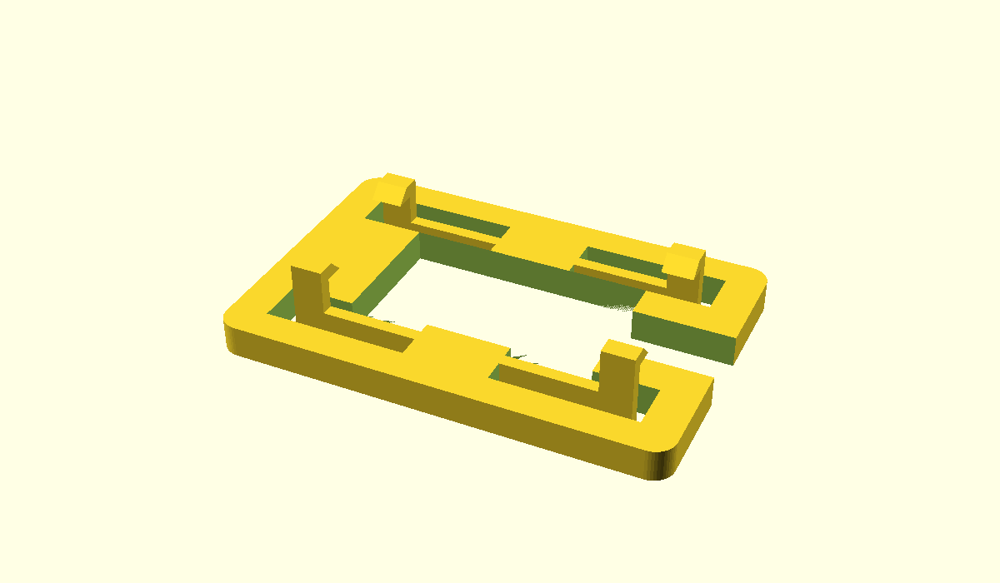

# Checkpoint 3: cable slot and snap tabs

Print **one** [V2 cradle](../cad/stl/servo-cradle-v2.stl). [Editable source](../cad/servo-cradle-v2.scad).

V1 trapped the side-exiting cable during insertion. This replacement has a 6mm-wide channel from the body opening to the outside edge. Four flexible tabs catch the mounting ears. No screws, glue, wire cutting or connector removal are part of this fit test.

The main opening remains 23.0 x 12.9mm. Unlike V1, this version uses the flange as its body guide and has no downward guide walls. The flange sits underneath the servo ears. The clips point upward, beside the ears, away from the shaft.



## Print
1. Use 100% scale: **42 x 28 x 7.2mm**. Flat face on bed, clips upward, as exported. Do not flip it for assembly.
2. Select your actual printer and filament profile. With a 0.4mm nozzle, start at 0.20mm layers and 3 walls. Inspect the sliced fingers and hook tips before printing.
3. Each hook has a short 1.9mm overhang. Try without supports for this fit sample; inspect for drooping before insertion. Do not leave support material between a finger and the frame.
4. Let the print cool. Check all four fingers for cracks or joined gaps. Lightly move each tip outward, away from the opening. Stop if it cracks or takes force. PLA may be brittle; this geometry has not been fatigue-tested in any material.

## Fit, with power unplugged
1. Unplug USB and the motor supply before handling the connected servo. Keep its wires attached.
2. Hold the cradle with clips up, below the mounting ears. Turn the cable-slot end toward the servo cable exit.
3. Slip the wire bundle sideways through the open channel into the large opening. The plug does not go through the channel.
4. Lower the servo body through the opening. Keep the side cable exit facing the channel. Do not pinch the wires.
5. Gently spread the tabs beside one ear and seat that ear; repeat at the other end. The hooks should overlap the ears, with both ears flat on the flange. Do not force a click.
6. Hold the servo and cradle over the table. Gently check whether the servo lifts out without releasing the clips. Do not shake it or hang a load from it.

## Remove
Support the servo. Ease the two clips at one end outward and lift that ear slightly, then release the other end. Lift the body out and slide the wire bundle out through the channel. Do not pull on the wires or pry against the shaft.

## Report
- Cable slides in freely: yes / no.
- Both ears sit flat: yes / no.
- All four hooks catch the ears: yes / no.
- Can release and remove without cracking: yes / no.

This is an **unpowered fit prototype**, not a tested robot mount. Do not attach a leg or run the mounted servo yet. Ear clearance is provisionally 2.9mm above the flange, based on the seller's 2.6mm ear thickness plus clearance. Hook reach, flexibility, cable clearance and strength need this physical check. A crack, permanent bend or poor latch means revise and reprint, not add glue.

## Reproduce
```powershell
openscad -o cad/stl/servo-cradle-v2.stl cad/servo-cradle-v2.scad
openscad -o cad/servo-cradle-v2-preview.png --imgsize=1200,700 --viewall --autocenter cad/servo-cradle-v2.scad
python scripts/validate_meshes.py
```
