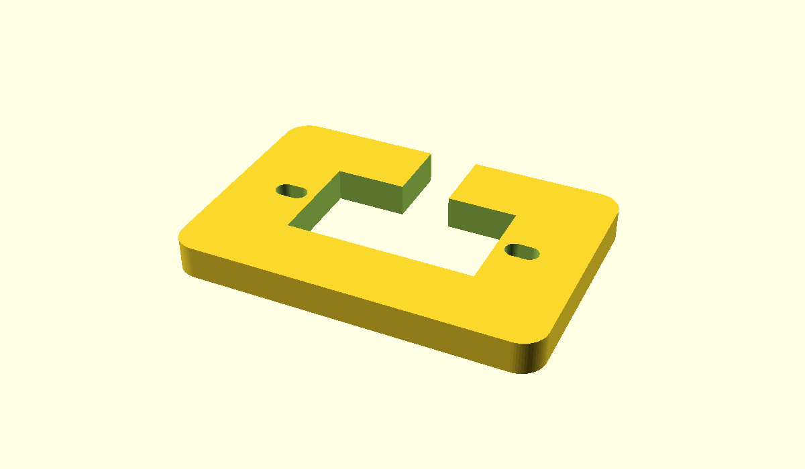
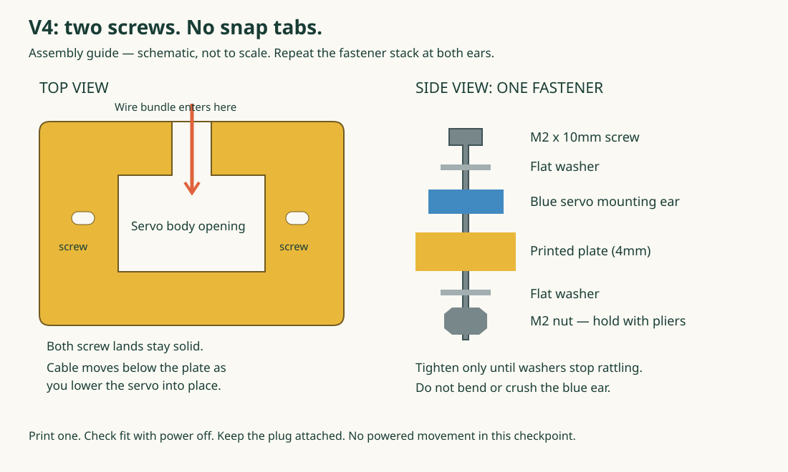

# Checkpoint 4: two screws hold the servo

**Print one V4 mount. Fit one servo. Keep the power off.** This replaces the snap-tab approach. The sensor/personality app is paused while we build the physical robot.

[Print this STL](../cad/stl/servo-cradle-v4.stl) · [Editable design](../cad/servo-cradle-v4.scad)



## Get your parts

For **one servo**, set out:

- One printed V4 mount.
- Two **M2 x 10mm socket-head machine screws**, standard M2 coarse thread (0.4mm pitch). Length is measured under the head.
- Two matching **M2 hex nuts**.
- Four **M2 flat washers**, approximately 5mm outside diameter: one above each servo ear and one beneath the mount. Use flat washers, not the split spring washers.
- A **1.5mm hex key** for standard M2 socket-head cap screws, plus small needle-nose pliers to hold the nuts. Confirm the key fits fully before turning.

For four mounts: **8 screws, 8 nuts, 16 flat washers**; get a few spares.

Amazon option: [VGBUY 840-piece M2 kit](https://www.amazon.com/dp/B0FJ1XLMJT). The Amazon listing reviewed on 2026-10-25 lists 4/6/8/10/12/16/20mm socket-head screws, matching nuts, flat washers and lock washers. Choose the **M2** variant, then use the **10mm** compartment. The older B0D472CPMY link returned this newer ASIN. Tool inclusion and delivery availability were not confirmed. Check your existing precision tool kit for a 1.5mm hex bit; otherwise [find a 1.5mm metric hex key on Amazon](https://www.amazon.com/s?k=1.5mm+metric+hex+key). Use existing small pliers if available; otherwise [Amazon needle-nose pliers](https://www.amazon.com/s?k=small+needle+nose+pliers).

**Why 10mm?** The design stack is about 4mm printed plate + 2.6mm seller-listed ear + two 0.3–0.5mm washers + about 1.6mm nut = 8.8–9.2mm. A 10mm screw should leave about 0.8–1.2mm beyond the nut. These hardware dimensions are a design allowance, not measured parts from your box.

**One quick check:** slide an M2 screw through one servo ear by hand before assembly. It must pass without being screwed into the plastic. The seller drawing does not specify that hole diameter. If it will not pass, stop and report it; do not drill the ear. M2 is the selected V4 design size, pending this physical check.

## Print

1. Open **servo-cradle-v4.stl** in Bambu Studio.
2. Keep **100% scale**. Check **44 x 30 x 4mm**.
3. Put the broad flat face on the bed. There are no clips or guide walls.
4. Start with PLA, a 0.4mm nozzle, 0.20mm layers, 4 walls and 30% infill. Use your filament's printer profile. No supports are intended.
5. Inspect the slicer preview: the two screw slots and cable entrance must remain open. Let the print cool before removing it.

These are prototype print settings. Do not print four until one passes the fit check.

## Put it together



1. Unplug USB and the servo power supply. Leave the servo cable attached to the servo.
2. Bring a loose section of cable sideways through the **long-side gap** into the big opening. Only the wire bundle passes through the gap; the plug stays attached. Leave slack.
3. Lower the servo body into the opening, easing the cable below the plate as you lower it. Both mounting ears must rest flat on top. Do not bend the cable sharply at its exit or trap it under an ear.
4. Put a flat washer on a 10mm screw. Pass it down through one servo ear and the printed slot. The washer must sit flat without pressing on the raised servo case.
5. Under the plate, add a flat washer and nut. Start the nut with your fingers. Repeat at the other end. Leave both loose until both screws are in place.
6. Hold one nut with pliers. Turn its screw with the hex key until the washers just stop rattling. Do the same at the other end. **Stop there. Do not squeeze or bend the blue ears.** Do not use a powered driver.
7. Check that the threads go through each whole nut, with about two or three threads visible beyond it. If they do not, check the part stack; do not compensate by crushing the plastic.

The nuts stay exposed so you can see and hold them. No glue, heat-set inserts, hidden pockets, or friction-fit clips are needed. These screws mount the case; they do not replace the small screw that attaches the servo horn to the shaft.

## Check your work

Hold the assembly over the table. Gently rock the **servo case**, not the shaft or cable.

- Both ears sit flat; washers are flat; no cracks or white stress marks.
- Servo does not lift out or rock relative to the plate.
- Cable has slack and is not squeezed against a sharp edge.
- Both nuts can still be reached with pliers; both screws can be reached from above.
- Remove and reinstall it once. It should be easy to service.

If it rocks, inspect the fit rather than tightening harder. Report which part moves. Before adding a leg, we still need to test a secured mount and limited movement under its actual load. The previously successful bare-servo sweep is not a validated range for a leg. No motor command is part of this checkpoint.

## Engineering challenge: how could this fail?

- **Cable slot destroys a screw support:** V4 moves entry to the long side. Both short-end screw lands stay solid; the opposite long rail is continuous.
- **Snap breaks or creeps:** no snap tabs. Metal fasteners retain the ears; the successful 23 x 12.9mm opening locates the body.
- **Nut pocket prints too tight or spins:** no pocket. Ordinary exposed nuts can be held with pliers. Tradeoff: assembly uses two tools.
- **Overtightening cracks a servo ear:** flat washers distribute contact, and the plate supports each ear. Hand tightening still matters; this is not torque-proof.
- **Unknown hole spacing:** 2.4mm-wide slots retain V1's 13.8–15.4mm center adjustment on each side. This does not prove the servo hole diameter or washer clearance; the unpowered check is required.
- **A slot breaks through to the opening:** minimum nominal inner ligament is 1.1mm. It is a fit-prototype limitation, not a rated structural connection. Watch for cracks near slots; do not hang the robot from this sample.
- **Print bends at the cable gap:** 4mm plate and 8.55mm continuous rear rail improve the section over the 3mm predecessor. No measured strength or finite-element result is claimed.
- **Nut loosens under movement / plastic creeps:** inspect before each early test and after the first movement session. If it loosens, stop; a later revision may need M2 locking nuts and a revised screw stack. Do not use liquid threadlocker on the plastic assembly.
- **The future chassis blocks access:** this sample has no chassis attachment points yet. Reserve access underneath for pliers and screw protrusion before integrating it into a body.

**Evidence:** mesh geometry is checked computationally; retention, cable insertion, M2 fit, washer clearance and load capacity remain physically untested. This is a more serviceable prototype, not a bulletproof claim.

## Reproduce

With OpenSCAD 2021.01 available, run from the repository root:

```powershell
openscad -o cad/stl/servo-cradle-v4.stl cad/servo-cradle-v4.scad
openscad -o cad/servo-cradle-v4-preview.png --imgsize=1200,700 --viewall --autocenter cad/servo-cradle-v4.scad
python scripts/validate_meshes.py
```
