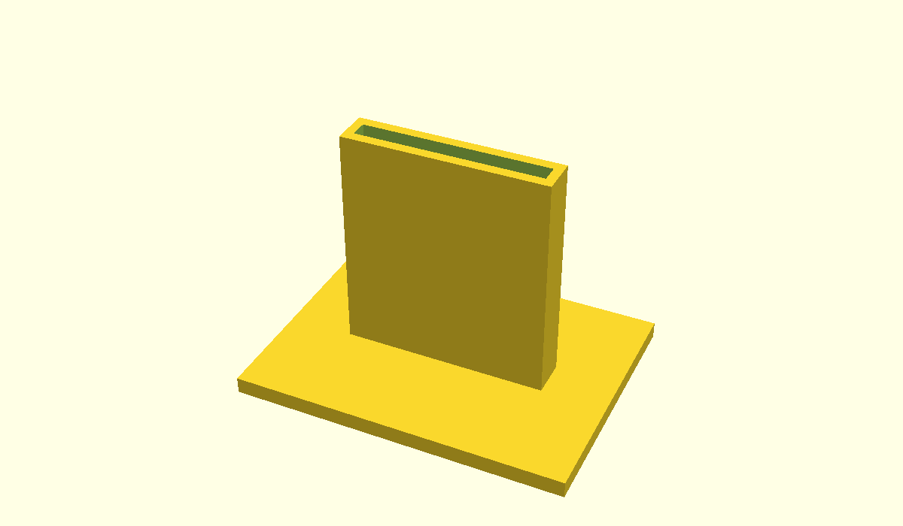
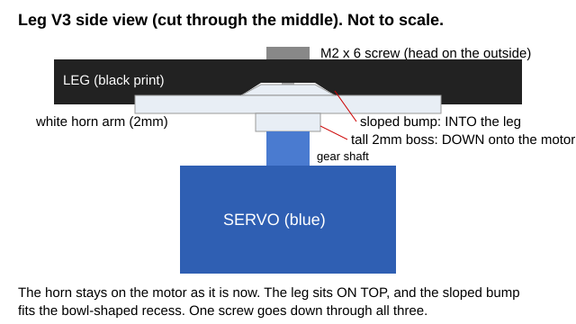
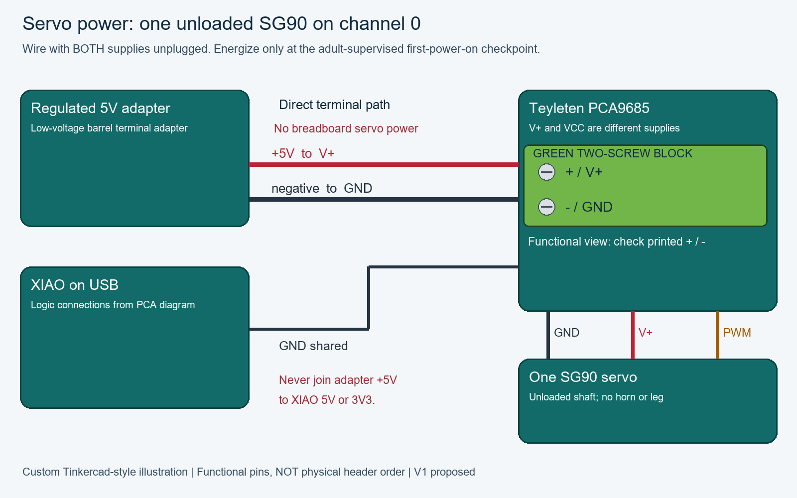

# Checkpoint 5: one working leg

**Print one leg and one stand. Put the leg on your V4 servo. Measure how far it turns.** This is step 1 of the walking-dog plan: one leg first, then four legs and a body, then walking, then feelings.

**Big idea:** the computer sends the motor a number (a pulse in microseconds, written **us**). The leg turns to an angle. Today you find out which number makes which angle. You will use your numbers in checkpoint 6 to make the dog stand.

[Leg V3 STL](../cad/stl/leg-v3.stl) · [Stand STL](../cad/stl/leg-stand-v1.stl) · [Editable leg](../cad/leg-v3.scad) · [Editable stand](../cad/leg-v1.scad) · [Leg program](../lessons/sketches/Leg/Leg.ino)


**Use Leg V3.** Andrew noticed that the bump on the horn's top side is not a flat disc: its sides slope, like a tiny hill. Leg V3 has a sloped, bowl-shaped recess to match, and is 0.3mm thicker so the screw still has 2mm of plastic to squeeze. If you already printed Leg V2, try it too and tell us which fits better.

Why not V1 or V2? Leg V1 did not fit: the horn is about 36mm long, not the 33mm the listing suggested, and its raised middle hit V1's flat pocket floor. V2 and V3 are shaped from photos of your own horn on the [measuring sheet](measure/README.md).



## Meet the new parts

- **Leg:** a printed bar. The big end has a **pocket** shaped like the servo horn, a deeper round **recess** for the horn's middle, and a small **screw hole** in the centre. The narrow end is the **foot**. A small groove on the flat side marks the foot end.
- **Stand:** a printed tower on a flat base. Your V4 mount slides into the **slot** on top, so the leg can hang down and swing without hitting the table.
- **Double-arm horn:** the long, straight plastic arm with two sides that came in your servo bag. It pushes onto the servo's gear shaft. You did not use a horn in the lessons.
- **Clamp screw:** one **M2 x 6mm** screw from the same M2 kit you used in checkpoint 4. It goes through the leg and the horn into the servo shaft, and squeezes them together.
- **Horn's two sides:** one side of the horn has a round **boss** (a short tube with teeth inside) that pushes onto the motor. The other side is nearly flat. The flat side goes into the leg.

Keep from checkpoint 4: your V4 mount with the servo screwed in. Keep from lesson 6: the XIAO, the PCA9685 driver, the 5V motor supply and the USB cable.

## Print

1. Open **leg-v3.stl** and **leg-stand-v1.stl** in Bambu Studio. Keep **100% scale**.
2. Check the sizes. Leg: **13 x 70 x 5.3mm**. Stand: **80 x 60 x 58mm**.
3. Leg: keep the **pocket facing up**. Use PLA, 0.20mm layers and 4 walls.
4. Stand: base flat on the bed. 3 walls and 15% infill is enough.
5. No supports are intended. In the slicer preview, the pocket, the round recess and the centre hole must stay open.

Print one leg only. You will print three more in checkpoint 6, after this one works.

## Part A: check the horn and screws (power off)

**Predict:** will the horn sit flat inside the leg pocket? Write yes or no.



The horn stays the same way up as it sits on the motor: tall boss **down** toward the motor, sloped bump **up**. The leg goes **on top** of it, like a lid.

1. Lay the leg on the table with its pocket facing up. Turn the horn upside down (tall boss up) and drop it into the pocket. The sloped bump drops into the round, bowl-shaped recess.
2. Flip both over together: now the leg is on top and the tall boss points down, ready for the motor.
3. **Expected:** the horn sits flush with the top of the leg, with a tiny gap around the arms. It does not need pushing, and it cannot turn in the pocket.
4. Find one **M2 x 6mm** screw in the M2 kit.

**Stop and report** if the horn sticks up above the leg, rocks, or will not go in. Say which part catches: the tips, the arms beside the middle, or the middle.

**Evidence:** write "fits / too tight / too loose" and where it catches.

## Part B: put the motor in the middle

The leg must go on when the motor is at its middle position, **1500 us**. The Leg program goes to 1500 us first, so you will use it to center the motor before the leg goes on.

1. Unplug USB and the motor supply. Wire the servo to **channel 0** exactly as in lesson 6. Use the picture and the table below.
2. No horn on the motor yet. Set the V4 mount on the table with the shaft pointing up.
3. Plug in USB only. In PowerShell, from the repository folder, type each line and press Enter. Use your own COM number; COM5 is only an example.

```powershell
.\robot.ps1 ports
.\robot.ps1 upload -Sketch Leg -Port COM5 -ServoPowerDisconnected
.\robot.ps1 monitor -Port COM5 -ServoPowerDisconnected
```

4. In the monitor, type `test` and press Enter.
5. Ask the adult to check the wires and turn on the 5V motor supply.
6. Type `run` and press Enter. Watch for this line:

```text
HOLD 1 of 9: 1500 us. Read the leg angle now.
```

7. As soon as you see **HOLD 1**, type `stop` and press Enter.
8. Ask the adult to unplug the motor supply. The shaft stays where it stopped: the middle.



| From / pin | To / pin | Meaning |
|---|---|---|
| Adapter positive | PCA green block: + / V+ | Regulated 5V; direct power wire |
| Adapter negative | PCA green block: - / GND | Direct power wire |
| XIAO 3V3 | PCA VCC | Logic power, separate from V+ |
| XIAO GND | PCA GND | Common reference |
| XIAO D4 / GPIO6 | PCA SDA | I2C data |
| XIAO D5 / GPIO7 | PCA SCL | I2C clock |
| PCA channel 0 GND | SG90 ground | Usually brown/black; verify |
| PCA channel 0 V+ | SG90 power | Usually red; verify |
| PCA channel 0 PWM | SG90 signal | Usually orange/yellow; verify |

Same wiring as lesson 6. This is a functional picture, not an exact hole-placement diagram. Read the printed board labels.

## Part C: build the leg (power off)

Motor supply stays unplugged for this whole part. Do not turn the shaft by hand; that can strip its tiny gears.

1. Put the horn in the leg pocket as in Part A, so the tall boss sticks out of the pocket.
2. Slide your V4 mount into the stand slot. The **long edge without the cable gap** goes down into the slot. The servo shaft points toward you.
3. Hold the leg and horn together. Turn them so the foot points **straight down**. Push the horn's boss onto the shaft. The teeth only allow certain steps; choose the step closest to straight down.
4. Push the M2 x 6mm screw through the hole in the middle of the leg. Turn it with the 1.5mm hex key until it is snug. It goes through the leg and the horn and into the motor shaft. Do not force it.
5. Put a heavy book on the stand's base so it cannot tip over.

**If the screw spins without biting,** or will not start, stop and report it. Nobody has checked yet that an M2 screw matches the hole in this servo's shaft.

**Optional extra hold:** the leg has two tiny starter holes under the 4th horn hole on each arm. If your servo bag has tiny pointed screws, one in each hole stops the leg working loose.

**Check:** gently wiggle the foot. The leg should not slide on the horn. A little play from the motor gears is normal.

## Part D: measure the angles

**Predict:** at 1000 us and at 2000 us, how far will the leg turn from straight down? Write a guess in degrees.

1. Hold a clear protractor upside down in front of the leg. Put its center mark on the shaft screw, its straight edge level, and its 90° mark straight down. A leg pointing straight down reads 90.
2. Make sure the leg can swing freely and hands are clear.
3. In the monitor, type `test`. Ask the adult to turn on the 5V motor supply. Type `run`.
4. The leg moves to 9 poses. It holds each one for 4 seconds. Each time you see **HOLD**, read the angle and write it in your table.
5. After about one minute you will see **DONE**. Ask the adult to unplug the motor supply.

| HOLD | Pulse (us) | Angle you read |
|---|---|---|
| 1 | 1500 | |
| 2 | 1250 | |
| 3 | 1500 | |
| 4 | 1750 | |
| 5 | 1500 | |
| 6 | 1000 | |
| 7 | 1500 | |
| 8 | 2000 | |
| 9 | 1500 | |

**Stop right away** (type `stop`, then the adult unplugs the motor supply) if the leg hits anything, the motor keeps buzzing, the stand tips, or the leg slips on the horn.

## Evidence and exit ticket

1. Does the leg come back to the same angle at every 1500 us HOLD? Yes, no or not sure.
2. Work out **degrees per 100 us**: take the difference between the angles at 2000 and 1000 (big number minus small number), then divide by 10. Show your sum.
3. Was your prediction close? What surprised you?
4. Send the table and a photo of the leg on the stand. Those numbers become this leg's settings in checkpoint 6.

Write: **prediction → command → what you saw → explanation → next question.**

## Engineering challenge: how could this fail?

- **The pocket is the wrong size again:** V3 comes from grid-sheet photos measured to about 0.2mm, with 0.2mm of clearance on each side. Part A checks the fit before anything is screwed. The [horn gauge](measure/README.md) shows how your printer prints small holes.
- **The clamp screw loosens or strips:** the leg has 2mm of plastic under the hub for the screw to squeeze. Check it is snug before each run. The two optional tiny screws add a second hold.
- **The leg is not straight at 1500 us:** the horn teeth only allow certain steps. Write down how far off it is. Checkpoint 6 can correct this in software.
- **The leg hits the table:** at the middle position the foot is about 15mm above the stand's base. The poses only use 1000 to 2000 us, which is gentler than lesson 6.
- **The stand tips over:** the book on the base stops this. The slot holds the mount by friction only. If it wobbles, wedge a folded strip of paper into the slot.
- **The numbers are a guess about angle:** the program sends pulse numbers. It cannot see the leg. Only your protractor readings are evidence.

**What is not tested yet:** the leg and stand are new designs. Their meshes passed the computer checks, but nobody has printed Leg V3, fitted a horn to it, or moved a leg yet. Leg V1 was printed and did not fit. The Leg program has not been built with the full toolchain or run on the board.

## Reproduce

With OpenSCAD 2021.01, from the repository root:

```powershell
openscad -o cad/stl/leg-v3.stl cad/leg-v3.scad
openscad -o cad/stl/leg-stand-v1.stl -D 'part="stand"' cad/leg-v1.scad
openscad -o cad/leg-v3-preview.png --imgsize=1200,700 --viewall --autocenter cad/leg-v3.scad
openscad -o cad/leg-stand-v1-preview.png -D 'part="stand"' --imgsize=1200,700 --viewall --autocenter cad/leg-v1.scad
python scripts/validate_meshes.py
.\robot.ps1 build -Sketch Leg
```
