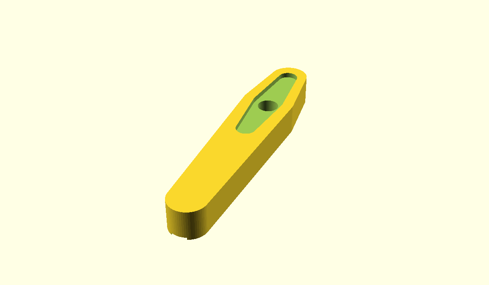

# Checkpoint 5: one working leg

**Print one leg and one stand. Put the leg on your V4 servo. Measure how far it turns.** This is step 1 of the walking-dog plan: one leg first, then four legs and a body, then walking, then feelings.

**Big idea:** the computer sends the motor a number (a pulse in microseconds, written **us**). The leg turns to an angle. Today you find out which number makes which angle. You will use your numbers in checkpoint 6 to make the dog stand.

[Leg STL](../cad/stl/leg-v1.stl) · [Stand STL](../cad/stl/leg-stand-v1.stl) · [Editable design](../cad/leg-v1.scad) · [Leg program](../lessons/sketches/Leg/Leg.ino)




## Meet the new parts

- **Leg:** a printed bar. The big end has a **pocket** shaped like the servo horn and a round **screwdriver hole** in the middle. The narrow end is the **foot**. A small groove on the flat side marks the foot end.
- **Stand:** a printed tower on a flat base. Your V4 mount slides into the **slot** on top, so the leg can hang down and swing without hitting the table.
- **Double-arm horn:** the long, straight plastic arm with two sides that came in your servo bag. It pushes onto the servo's gear shaft. You did not use a horn in the lessons.
- **Horn screws:** two small pointed screws from the servo bag. They hold the horn inside the leg pocket. The servo bag also has one very short screw. That one is the **shaft screw**: it holds the horn on the motor.

Keep from checkpoint 4: your V4 mount with the servo screwed in. Keep from lesson 6: the XIAO, the PCA9685 driver, the 5V motor supply and the USB cable.

## Print

1. Open **leg-v1.stl** and **leg-stand-v1.stl** in Bambu Studio. Keep **100% scale**.
2. Check the sizes. Leg: **14 x 70 x 8mm**. Stand: **80 x 60 x 58mm**.
3. Leg: keep the **pocket facing up**. Use PLA, 0.20mm layers, and **6 walls**, so the horn screws have solid plastic to bite.
4. Stand: base flat on the bed. 3 walls and 15% infill is enough.
5. No supports are intended. In the slicer preview, the pocket and the screwdriver hole must stay open.

Print one leg only. You will print three more in checkpoint 6, after this one works.

## Part A: check the horn and screws (power off)

**Predict:** will the double-arm horn drop into the leg pocket? Write yes or no.

1. Lay the horn in the pocket, flat side up. Its middle circle should sit over the screwdriver hole.
2. **Expected:** it drops in with a tiny gap all around. It does not need pushing.
3. Find the two pointed horn screws and the one short shaft screw. Measure the pointed screws with a ruler.

**Stop and report** if the horn is too long for the pocket, if you cannot find pointed screws, or if a pointed screw is **longer than 8mm**. A longer screw would poke out of the other side of the leg. The pocket size comes from the seller's listing, not from a measured horn.

**Evidence:** write "fits / too tight / too loose" and the screw lengths.

## Part B: put the motor in the middle

The leg must go on when the motor is at its middle position, **1500 us**. The Leg program goes to 1500 us first, so you will use it to center the motor before the leg goes on.

1. Unplug USB and the motor supply. Wire the servo to **channel 0** exactly as in lesson 6. Use the picture and the table below.
2. No horn on the motor yet. Set the V4 mount on the table with the shaft pointing up.
3. Plug in USB only. In PowerShell, from the repository folder, type each line and press Enter. Use your own COM number; COM5 is only an example.

```powershell
.\robot.ps1 ports
.\robot.ps1 upload -Sketch Leg -Port COM5 -ServoPowerDisconnected
.\robot.ps1 monitor -Port COM5 -ServoPowerDisconnected
```

4. In the monitor, type `test` and press Enter.
5. Ask the adult to check the wires and turn on the 5V motor supply.
6. Type `run` and press Enter. Watch for this line:

```text
HOLD 1 of 9: 1500 us. Read the leg angle now.
```

7. As soon as you see **HOLD 1**, type `stop` and press Enter.
8. Ask the adult to unplug the motor supply. The shaft stays where it stopped: the middle.


| From / pin | To / pin | Meaning |
|---|---|---|
| Adapter positive | PCA green block: + / V+ | Regulated 5V; direct power wire |
| Adapter negative | PCA green block: - / GND | Direct power wire |
| XIAO 3V3 | PCA VCC | Logic power, separate from V+ |
| XIAO GND | PCA GND | Common reference |
| XIAO D4 / GPIO6 | PCA SDA | I2C data |
| XIAO D5 / GPIO7 | PCA SCL | I2C clock |
| PCA channel 0 GND | SG90 ground | Usually brown/black; verify |
| PCA channel 0 V+ | SG90 power | Usually red; verify |
| PCA channel 0 PWM | SG90 signal | Usually orange/yellow; verify |

Same wiring as lesson 6. This is a functional picture, not an exact hole-placement diagram. Read the printed board labels.

## Part C: build the leg (power off)

Motor supply stays unplugged for this whole part. Do not turn the shaft by hand; that can strip its tiny gears.

1. Put the horn in the leg pocket, flat side up, as in Part A.
2. Drive one pointed screw down through a hole near **each end** of the horn, into the leg. Use the small Phillips screwdriver. Turn slowly. Stop when the screw head touches the horn. The screws cut their own thread in the plastic.
3. Slide your V4 mount into the stand slot. The **long edge without the cable gap** goes down into the slot. The servo shaft points toward you.
4. Turn the leg so the foot points **straight down**. Push the horn's center onto the shaft. The horn has teeth, so it clicks into steps; choose the step closest to straight down.
5. Put the short shaft screw through the screwdriver hole and turn it until it is snug. Do not force it.
6. Put a heavy book on the stand's base so it cannot tip over.

**Check:** gently wiggle the foot. The leg should not slide on the horn. A little play from the motor gears is normal.

## Part D: measure the angles

**Predict:** at 1000 us and at 2000 us, how far will the leg turn from straight down? Write a guess in degrees.

1. Hold a clear protractor upside down in front of the leg. Put its center mark on the shaft screw, its straight edge level, and its 90° mark straight down. A leg pointing straight down reads 90.
2. Make sure the leg can swing freely and hands are clear.
3. In the monitor, type `test`. Ask the adult to turn on the 5V motor supply. Type `run`.
4. The leg moves to 9 poses. It holds each one for 4 seconds. Each time you see **HOLD**, read the angle and write it in your table.
5. After about one minute you will see **DONE**. Ask the adult to unplug the motor supply.

| HOLD | Pulse (us) | Angle you read |
|---|---|---|
| 1 | 1500 | |
| 2 | 1250 | |
| 3 | 1500 | |
| 4 | 1750 | |
| 5 | 1500 | |
| 6 | 1000 | |
| 7 | 1500 | |
| 8 | 2000 | |
| 9 | 1500 | |

**Stop right away** (type `stop`, then the adult unplugs the motor supply) if the leg hits anything, the motor keeps buzzing, the stand tips, or the leg slips on the horn.

## Evidence and exit ticket

1. Does the leg come back to the same angle at every 1500 us HOLD? Yes, no or not sure.
2. Work out **degrees per 100 us**: take the difference between the angles at 2000 and 1000 (big number minus small number), then divide by 10. Show your sum.
3. Was your prediction close? What surprised you?
4. Send the table and a photo of the leg on the stand. Those numbers become this leg's settings in checkpoint 6.

Write: **prediction → command → what you saw → explanation → next question.**

## Engineering challenge: how could this fail?

- **The horn is a different size from the listing:** the pocket uses the seller's 33mm length plus 0.6mm clearance. Part A checks it before any screws go in.
- **The horn screws strip the plastic:** 6 walls give them solid plastic. Turn them gently by hand and stop when the head touches.
- **The leg is not straight at 1500 us:** the horn teeth only allow certain steps. Write down how far off it is. Checkpoint 6 can correct this in software.
- **The leg hits the table:** at the middle position the foot is about 15mm above the stand's base. The poses only use 1000 to 2000 us, which is gentler than lesson 6.
- **The stand tips over:** the book on the base stops this. The slot holds the mount by friction only. If it wobbles, wedge a folded strip of paper into the slot.
- **The numbers are a guess about angle:** the program sends pulse numbers. It cannot see the leg. Only your protractor readings are evidence.

**What is not tested yet:** the leg and stand are new designs. Their meshes passed the computer checks, but nobody has printed them, fitted a horn, or moved a leg yet. The Leg program has not been built with the full toolchain or run on the board.

## Reproduce

With OpenSCAD 2021.01, from the repository root:

```powershell
openscad -o cad/stl/leg-v1.stl -D 'part="leg"' cad/leg-v1.scad
openscad -o cad/stl/leg-stand-v1.stl -D 'part="stand"' cad/leg-v1.scad
openscad -o cad/leg-v1-preview.png -D 'part="leg"' --imgsize=1200,700 --viewall --autocenter cad/leg-v1.scad
openscad -o cad/leg-stand-v1-preview.png -D 'part="stand"' --imgsize=1200,700 --viewall --autocenter cad/leg-v1.scad
python scripts/validate_meshes.py
.\robot.ps1 build -Sketch Leg
```
