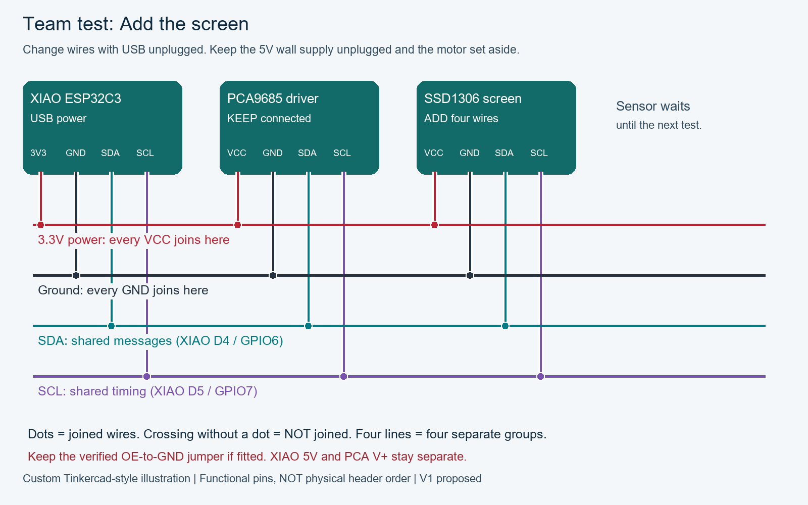
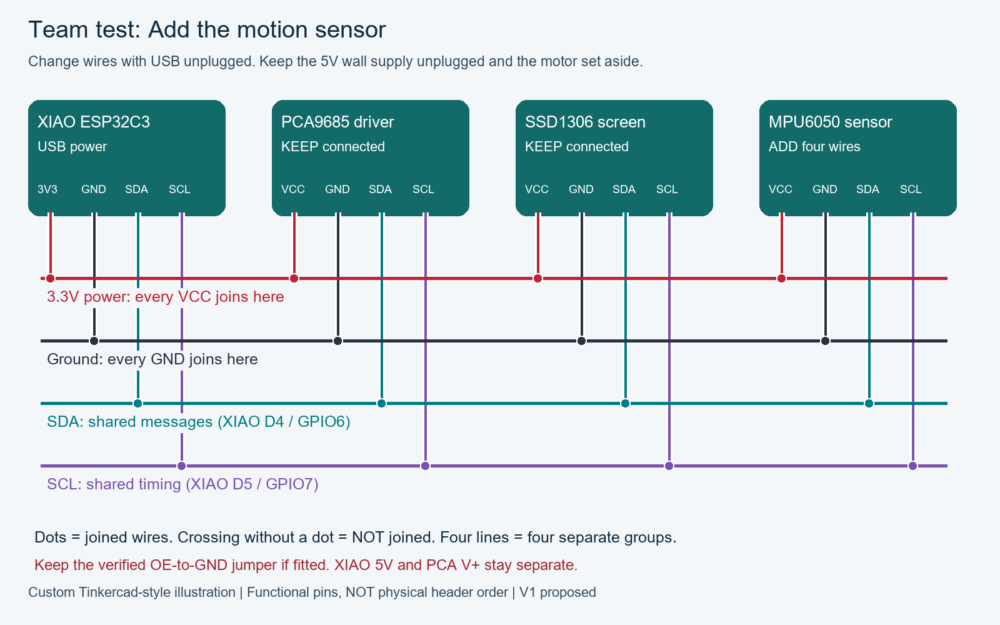

# Your first powered session

Wiring reference: [full pinout atlas and verification limits](wiring/README.md). Use the stage matching your lesson; do not connect every pictured module at once.

**Legacy Companion reference.** New learners should use [the current standalone course](../lessons/README.md). Commands in this document describe the older application, not the new Servo/Integration sketches.

This is the integration guide for lesson 5, after the standalone OLED and motion-sensor tests. Follow lesson 5A to verify PCA logic independently, then 5B for the driver output test with one motor, and 5C to combine the tested modules. It is not the starting point for lesson 1. The firmware is an early bench prototype, not a tested robot release. Start with the USB-powered XIAO and the tested modules from earlier lessons. New parts are introduced at their own checkpoint. Use the accompanying diagrams and [wiring table](WIRING.md).

## Upload

<!-- wiring:start -->
### Wiring visuals and pinouts

**Before changing wires: close the serial monitor if it is open, then unplug the XIAO USB cable. USB is the power source for this experiment.** These are functional illustrations: locate terminals by their printed labels. Board shapes do not establish physical pin positions.


The green two-screw block is a separate power input: one terminal is + / V+, the other is - / GND. It stays empty during this communication-only test; the driver electronics receive power through VCC. Follow the board markings, not a guessed left/right position. Functional pinout: VCC = logic 3.3V; V+ = separate output-power input; GND = common ground; SDA/SCL = I2C; OE = active-low output enable. Exact clone header order is unconfirmed. Verify OE pull-down; ground OE only if floating. Use only VCC, GND, SDA and SCL for this communication test. Leave V+ and the numbered output connectors empty.

| From / pin | To / pin | Meaning |
|---|---|---|
| XIAO 3V3 | Teyleten PCA9685 VCC | 3.3V logic |
| XIAO GND | Teyleten PCA9685 GND | Shared ground |
| XIAO D4 / GPIO6 | Teyleten PCA9685 SDA | I2C data |
| XIAO D5 / GPIO7 | Teyleten PCA9685 SCL | I2C clock |

<!-- wiring:end -->

**Entry checkpoint:** complete lesson 5A with only XIAO + PCA logic connected as shown above. The individually tested OLED and GY-521 are set aside. USB is the only power connection. If Companion is already running from 5A, keep it; skip the upload and proceed to “One servo, no leg attached” for lesson 5B. Return to the combined checks only after that independent driver output test.

For the repository terminal workflow, complete [setup](SETUP.md), identify the port with `./robot.ps1 ports`, then run `./robot.ps1 upload -Sketch Companion -Port COM7 -ServoPowerDisconnected` using your actual port. Open the console with `./robot.ps1 monitor -Port COM7 -ServoPowerDisconnected` with USB as the only power connection. The switch records your physical check; it cannot measure power. The following IDE steps are an optional alternative.

1. Install Arduino IDE, ESP32 board package **3.3.0**, and the exact libraries listed in `firmware/README.md`.
2. Open `firmware/Companion/Companion.ino`. Select **XIAO_ESP32C3** and the connected port. Set **USB CDC On Boot: Enabled** where that option appears.
3. With XIAO + PCA logic connected, upload over the USB data cable.
4. Open Serial Monitor at **115200**, with **Newline** line endings. Enter `help`, then `status` and `scan`.
5. Power off USB before adding each module. Reconnect and reboot after wiring changes. Confirm addresses and status after each addition.

Command output is plain text; no application or Wi-Fi credentials are required. At this driver-only checkpoint, PCA should be available; missing OLED and IMU are expected. After the modules pass the next checkpoint, the screen blinks and looks around, goes to sleep after 30 seconds without interaction, and responds to a double tap with a happy face. Tap sensitivity and orientation thresholds still require real-hardware tuning.

### Where to type the board commands

After `Connecting to COM5. Press CTRL-C to exit.` (your port number may differ), the terminal is the **serial monitor**. Click in that same terminal, type one command, and press **Enter** to send it to the XIAO:

```text
help
scan
status
```

Send each line separately and read its response. Do not include backticks or type these at the `PS ...>` PowerShell prompt. Your typing may or may not be echoed. Companion waits for Enter before acting. Unlike Scanner, it does not repeat scans automatically.

You may miss the beginning of the startup message while the monitor connects. Type `help` to print the command list again; no upload is needed. Press **Ctrl+C** when finished to return to PowerShell. Close the monitor before another upload or another program opens the same port.

## One servo, no leg attached

<!-- wiring:start -->
**Starting state:** only the XIAO and independently tested PCA9685 logic are connected, with Companion running. The tested OLED and GY-521 are set aside. **New parts:** one SG90 servo motor, a regulated 5V wall power supply, its low-voltage barrel-to-screw-terminal connector, prepared power wires, and the multimeter. The servo turns its shaft in response to the driver signal. The separate supply provides motor power; USB continues powering the XIAO. Identify these parts first. The wall supply has not been connected yet.

### Wiring visuals and pinouts

**Before assembling these connections: close the monitor and unplug the XIAO USB cable. Keep the newly introduced 5V supply unplugged from the wall until the voltage-check step. On a repeat session, unplug it before changing wires.** These are functional illustrations: locate terminals by their printed labels. Board shapes do not establish physical pin positions.


**Identify the green two-screw block on the PCA9685:** its + / V+ terminal accepts the regulated 5V supply positive wire; its - / GND terminal accepts the negative wire. They are not both V+. This block is not VCC, and it is different from the separate barrel-to-terminal connector on the supply cable. Confirm the actual board markings with power unplugged; the illustration does not establish left/right orientation. Functional servo pinout: ground, power, signal. Read the driver row labels before inserting the plug. **Keep all four XIAO logic wires connected**, as shown in this complete diagram: 3V3/VCC, GND/GND, D4/SDA and D5/SCL. The shared-ground wire is one of these four wires, not an extra fifth wire. Channel 0 is the three-pin output group beside the printed 0 among groups 0 through 15. One plug spans GND, V+ and signal within that group, not three neighboring channel numbers. The green block is not channel 0. Verify actual markings; left/right orientation is not established by this diagram. Use only channel 0 for this experiment. USB and adapter grounds meet at PCA GND; adapter positive never meets XIAO 5V or 3V3. Grounded OE is not a reset interlock: unplug servo power for uploads, resets and horn fitting.

| From / pin | To / pin | Meaning |
|---|---|---|
| Adapter positive | PCA green block: + / V+ | Regulated 5V; direct power wire |
| Adapter negative | PCA green block: - / GND | Direct power wire |
| XIAO 3V3 | PCA VCC | Logic power, separate from V+ |
| XIAO GND | PCA GND | Common reference |
| XIAO D4 / GPIO6 | PCA SDA | I2C data |
| XIAO D5 / GPIO7 | PCA SCL | I2C clock |
| PCA channel 0 GND | SG90 ground | Usually brown/black; verify |
| PCA channel 0 V+ | SG90 power | Usually red; verify |
| PCA channel 0 PWM | SG90 signal | Usually orange/yellow; verify |


Probe-jack pinout is functional, not the physical socket position of every meter variant. Select DC voltage before probing. Verify barrel size and polarity against the actual adapter; do not assume center-positive from a generic picture.

| From / pin | To / pin | Meaning |
|---|---|---|
| Black probe / COM jack | Adapter negative output | Voltage check only |
| Red probe / V-ohm jack | Adapter positive output | DC volts; never current mode |

<!-- wiring:end -->

**Start with the [guided motor lab](MOTOR-LAB.md): type `motor`, read the preparation steps, then type `go` only after the adult wiring/power check. The guide identifies channel 0 and explains what to observe.**

1. Close the monitor and unplug the XIAO USB cable. With the new 5V wall supply still unplugged, prepare its low-voltage connector and wires using the diagram. Keep the supply output disconnected from the driver while the adult checks its voltage and polarity with the meter. Follow the meter diagram: temporarily power the supply for that measurement, then unplug it again. Attach one unloaded servo to channel 0 and connect the verified output wires to PCA V+ and GND.
2. Start controller USB with servo power still off. `status` should report PCA available and no active channel.
3. After the adult checks the assembled terminal polarity against the measured output, plug the 5V supply into the wall. Keep the motor shaft clear. This is the first time the motor receives power.
4. Type `motor`, follow its instructions, then type `go` for the first output check: saved center for 500ms, center +10us for 500ms, then automatic pulse-off request. Observe the unloaded shaft. An unknown initial shaft position may move noticeably to center; the subsequent 10us change may be barely visible. No visible response is inconclusive. Confirm `Timed test: off` and `Calibration channel: none` after completion. A separate repeat can be interrupted with `stop`; verify it does not resume.
5. For later supervised calibration, enter `cal 0` to activate the channel at its saved center. Then enter `jog 0 10` or `jog 0 -10` for small adjustments. Default limits are 1450-1550us, intentionally narrow. A 15-second gap without a calibration command disables pulses.
6. Enter `stop` to disable pulses. Unplug servo power before installing a horn. Pulse-off does not disconnect electrical power or guarantee the leg stays upright.

To change limits while stopped, use `limits 0 1400 1600`. The firmware rejects bounds outside 1300-1700us. Never widen limits without physically inspecting the available travel. `center 0` sets the current active pulse as center, provided it is strictly inside the limits. `invert 0` reverses future gesture direction while stopped. Any changed calibration needs saving again.

Only after physically checking the servo and mounted geometry, enter `save 0`. This is your explicit confirmation; firmware cannot detect binding. Repeat for channels 1, 2 and 3. `status` lists saved flags; saved settings survive reboot, but arming never does.

## Face and motion-sensor checks

<!-- wiring:start -->
### Wiring visuals and pinouts

**5C setup:** keep the 5V wall supply unplugged and the motor plug removed. Close the monitor and unplug USB before each wiring change. Keep the tested PCA logic connections and any OE-to-GND jumper from 5B. These are functional illustrations: locate terminals by their printed labels. Board shapes do not establish physical pin positions.



Models: Seeed XIAO ESP32C3, Teyleten PCA9685, AITRIP SSD1306 OLED. Read the printed pin labels on each board. Each colored line means one connected breadboard group, not a physical row or rail. The picture rearranges pins to make the four connections easy to follow; it is not a top-view placement guide. Colors are suggestions. Use the XIAO D4 pin for SDA and D5 for SCL.

| From / pin | To / pin | Meaning |
|---|---|---|
| 3V3 | PCA + OLED VCC | Power for the electronics |
| GND | PCA + OLED GND | Shared ground |
| D4 / GPIO6 | PCA + OLED SDA | Messages |
| D5 / GPIO7 | PCA + OLED SCL | Timing |



Models: Seeed XIAO ESP32C3, Teyleten PCA9685, AITRIP SSD1306 OLED, and GY-521 / MPU6050. Read the printed pin labels on each board. Each colored line means one connected breadboard group, not a physical row or rail. The picture rearranges pins to make the four connections easy to follow; it is not a top-view placement guide. Colors are suggestions. Use the XIAO D4 pin for SDA and D5 for SCL.

| From / pin | To / pin | Meaning |
|---|---|---|
| 3V3 | PCA + OLED + GY-521 VCC | Power for the electronics |
| GND | PCA + OLED + GY-521 GND | Shared ground |
| D4 / GPIO6 | PCA + OLED + GY-521 SDA | Messages |
| D5 / GPIO7 | PCA + OLED + GY-521 SCL | Timing |

<!-- wiring:end -->

**Follow the [kid-friendly 5C walkthrough](../lessons/legacy.md#5c-combine-the-three-verified-modules)** for the four breadboard meeting places, one-wire-at-a-time steps, monitor commands and checkpoints. The first picture adds the screen; the second adds the sensor. Keep any OE-to-GND jumper fitted in 5B.

**5C: combine already verified modules.** Close the monitor, unplug USB and the 5V wall supply introduced in 5B, and remove the motor plug before adding logic modules. Keep the driver that passed lesson 5A connected. The diagrams show shared connections: matching 3V3, GND, SDA and SCL nets join through checked low-current breadboard junctions.

1. Close the monitor and unplug USB. Add the previously tested OLED, keeping PCA logic connected. Reconnect USB and reopen the monitor. Run `scan`, `status` and a face command. Confirm both modules still work.
2. Close the monitor and unplug USB. Add the previously tested GY-521, keeping the other two modules. Reconnect USB and reopen the monitor. Confirm all recorded addresses (including optional PCA all-call 0x70), driver availability, face drawing and changing sensor readings.
3. Stop at any failure. With power off, remove the most recent addition and verify the previous passing setup before trying again. Do not proceed until the combined checks pass.

Companion stays installed throughout these additions; do not re-upload Face or Motion. Each USB reconnection restarts Companion so it can initialize the newly added device.

Try `face happy`, `face sleep`, and `face awake`. Check the acceleration messages; with the MPU's +Z axis up, Z should be near +9.8 m/s2 and `upright=1`. If the mounted sensor faces another direction, fix the mount or deliberately update the orientation transform before using demo mode. For this checkpoint, record the readings; do not start gesture mode.

## Short gesture demo

With all four calibrations saved, the IMU connected and +Z up, enter `demo`. It performs a 10-second small synchronized gesture, at most +/-25us around each center and always within saved limits. It then disables pulses. This is not a walking gait. Support the chassis so removing pulses cannot make it fall. Enter `stop` at any time or unplug servo power.

## Limits of the current stop mechanism

The program disables PCA channels during initialization, on a calibration timeout, and on detected I2C failures. **It is not a hardware emergency stop.** A PCA9685 can retain PWM while the ESP32 reboots, freezes, loses USB power, or cannot communicate over I2C. Always disconnect servo power before uploading, resetting or repairing wiring. If software cannot talk to the PCA, it cannot guarantee that pulse-off commands reached it. A future OE interlock with a pull-up is an optional hardware improvement, not currently wired or claimed.

## Report back

Copy the output from `status` and `scan`, plus a photo of the first printed gauges with your parts resting in them. Record whether the controller has a stable USB port, the OLED works, the IMU reads correctly and one servo moves without buzzing. These observations unlock the final enclosure and larger gestures.
