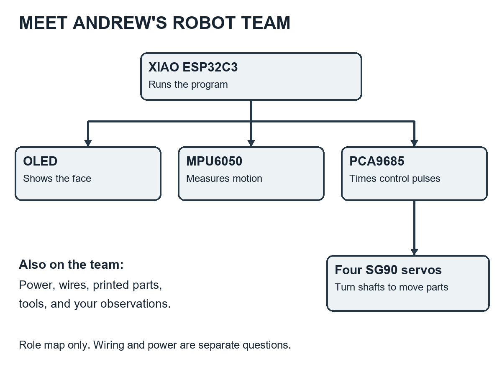
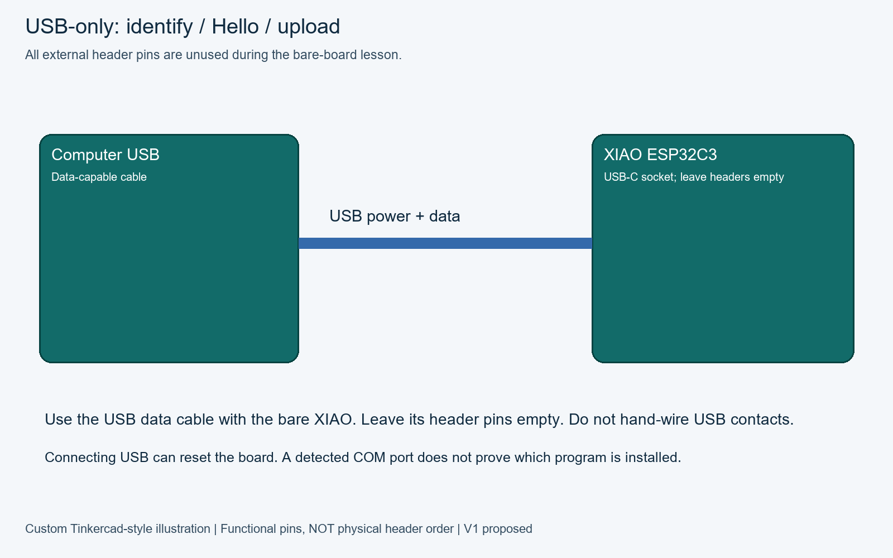
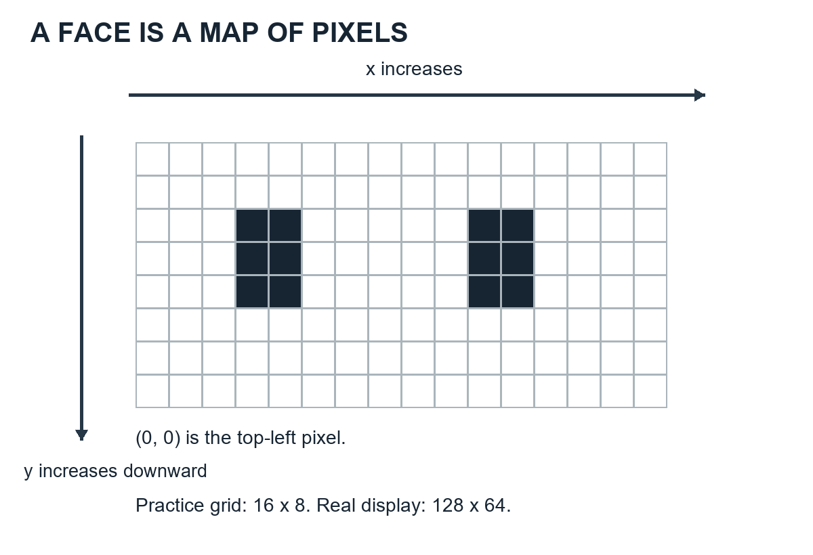
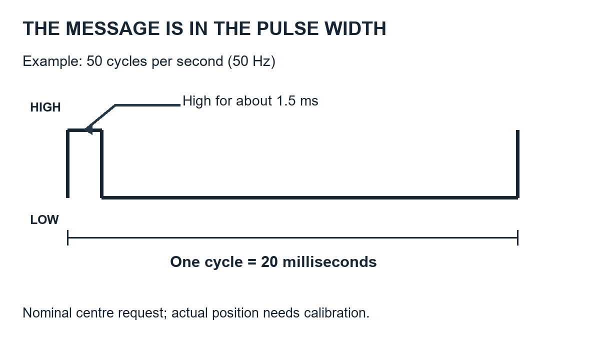
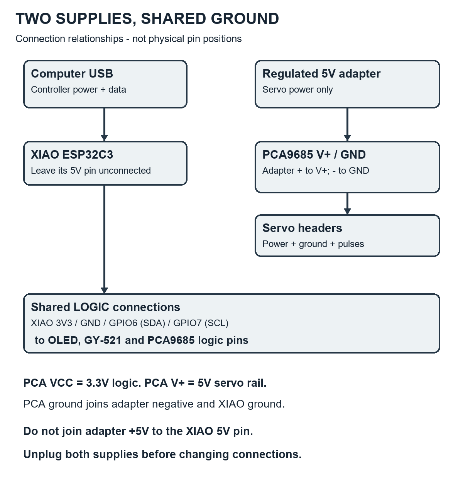
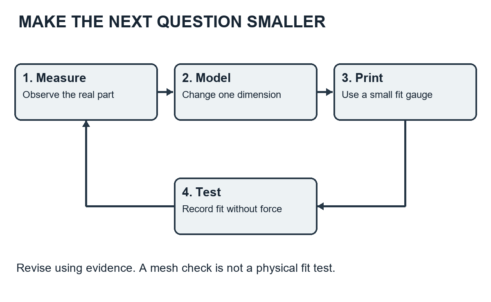

# Andrew and the Tiny Robot with Big Ideas

## A note from Mission Control

**A family adventure in circuits, code, and creating a desktop companion.**

Written especially for Andrew, age eleven, and the grown-up building beside him.

First edition • September 2026

Andrew, this book begins with an unusual promise: you do not have to understand every word before you start. You only need to be curious enough to ask what the next word means.

Your robot will have a small glowing face, four servos, a motion sensor, and a computer small enough to lose under a cookie. Please do not test the cookie theory. Crumbs are not an approved electronic component.

For our adventure, its nickname is **ANDI: Andrew’s New Desktop Inventor**. ANDI is a story character, not a new product you need to buy. When ANDI talks in these pages, that is imagination. Our real robot has no speaker or microphone, does not understand conversation, and has no human feelings. It can still have an excellent eyebrow attitude.

This book explains the project inspired by TN-24 and the independent desktop-companion-robot repository your family has started. It is an introduction, a workshop companion, and a collection of investigations. The live repository is the place to check the latest wiring and build instructions.

**Our honest starting point:** the bench firmware compiles, and two printable fit gauges have passed computer mesh checks. Hardware operation and printed fit have not yet been verified. The complete body, legs, walking behavior, browser controls, and battery system remain development work. A successful compilation is evidence about code; it is not evidence that a wire is in the right hole.

### How to use the adventure

Read a chapter together, then try its mission. Most missions need only paper, a pencil, or unplugged parts. Powered experiments are clearly marked and require an adult. You can read ahead without doing every experiment.

Each mission follows four moves: **predict, try, observe, explain**. A prediction that turns out wrong is useful. It tells you that your model of the world needs an update. That is what scientists and engineers do all day, with slightly more coffee.

For now, the building tool is Arduino IDE. Later, VS Code and command-line tools can join the workshop. Learning robotics should not begin with a battle against eleven unfamiliar programs.

### The workshop agreement

Andrew can lead the questions, draw designs, change approved code, keep the log, and explain results. The adult checks power connections, handles the first supply measurements, supervises servo tests, and manages printer hazards. Disconnect power before changing wiring. Keep fingers and cables away from moving joints. The printer’s hot nozzle and bed are adult-supervised territory.

Use only the low-voltage side of the sealed power adapter. Never open it or probe a wall socket. Keep the loose lithium batteries out of these V1 experiments. If something smells wrong, becomes unexpectedly hot, or moves strangely, stop and have the adult disconnect power. You are allowed to stop a test. You never have to prove bravery to a circuit board.

## 1. The day the parts became a team

Andrew spread the parts on the table.

“Which one is the robot?” he asked.

“At the moment,” ANDI replied from the imaginary corner of the workshop, “I am several unrelated rectangles.”

A robot is a system. Its parts become useful because they exchange energy, information, and force. A screen without a program is quiet. A program without electricity is also quiet. A servo without a plan may be very enthusiastic in an unhelpful direction.

Our system has five jobs. It receives energy. It senses something about the world. It decides what to do. It produces an action. Its physical structure holds everything in useful places.

The XIAO ESP32C3 runs instructions. The OLED makes a face. The MPU6050 measures motion-related quantities. The PCA9685 produces timed control pulses. Four SG90 servos turn their output shafts. Printed parts will hold the modules and turn shaft motion into a gesture. Wires connect the team. The power supply pays the energy bill.

Notice that “robot” does not automatically mean “artificial intelligence.” A robot can follow a short set of rules. If a double tap is detected, display happy eyes. If nobody interacts for a while, display sleepy eyes. These are programmed responses, and they are a fine beginning.



Our first version, V1, is corded. During bench development, that actually means two power leads: USB for the controller and a separate adapter for the servos. V2 is the future cordless version. Calling it V2 is a reminder that it must earn its place through tests, not sneak in because batteries look exciting.

The first useful success is not a walking robot. It might be a message in a window. Then a face. Then a tilt reading. Then one carefully controlled servo. Each success creates a trustworthy starting point for the next.

**Mission: recruit the team.** With everything unplugged, arrange the parts in groups: computation, sensing, output, power, connection, structure, and tools. Some belong in more than one group. Explain where the PCA9685 belongs and why. There is no penalty for a sensible alternative classification.

**Checkpoint:** is the OLED a sensor? No: in this project it shows information rather than measuring the outside world. The MPU6050 is the sensor. A servo is an actuator: it turns electrical energy into mechanical action.

## 2. Electricity without the mystery fog

“I require four electricity,” said ANDI.

“Four what?” Andrew asked.

“Excellent question. My request has failed its units test.”

Electricity becomes easier when you separate three ideas: voltage, current, and resistance.

**Voltage**, measured in volts, describes an electrical potential difference between two points. A water-pressure comparison can help you imagine it, although wires are not literally pipes. We care about voltage between points, not an isolated number floating in space.

**Current**, measured in amperes or amps, is the rate at which electric charge flows. A circuit needs a complete path. Energy reaches a device, and current returns through a connected path. The charge is not used up like fuel; energy is transferred to light, motion, heat, and other forms.

**Resistance**, measured in ohms, describes opposition to current. For a simple resistor, Ohm’s law is V = I × R. A 1,000-ohm resistor with 3.3 volts across it carries 0.0033 amps, or 3.3 milliamps. That is a paper calculation, not a request to connect random components. Motors and complete electronic boards do not behave like one fixed resistor in every condition.

**Power**, measured in watts, is the rate of energy transfer. For our DC examples, P = V × I. A device taking 0.2 amps at 5 volts uses 1 watt. A supply rated 5 volts and 4 amps can provide up to its rated current under its specified conditions. It does not force four amps through every connected gadget. The correct voltage matters, and the load draws current according to its behavior.

The servo supply is selected as 5V/4A. That is a maximum rated output of 20 watts, not a claim that our robot constantly uses 20 watts. A servo resting without much load may draw less than one pushing against a jam. A jam can turn your electrical budget into unwanted heat.

### Ground is the meeting place

GND is our circuit’s common reference and return connection. It is not necessarily connected to the Earth, and it is not a magic drain where electrons disappear. The controller and servo board need a shared reference to interpret signal voltages reliably.

Our 3.3V logic and 5V servo power have different jobs. A GPIO pin is a message connection, not a motor power outlet. Never try to run a servo from a XIAO GPIO or its 3V3 pin. We leave the XIAO’s 5V pin unconnected in our two-supply plan.

A short circuit creates an unintended low-resistance path. A stray wire strand between positive and ground can do that. This is why we inspect stripped wires before switching on. A tidy connection is an electrical decision, not a fashion decision.

**Mission: energy accountant.** On paper, calculate the power for 5V at 0.5A, then 5V at 2A. What changed? Predict whether a stalled servo could demand more current than an unloaded one. Do not deliberately stall a servo to find out.

**Answers:** 2.5W and 10W. Voltage stayed the same; current and power increased. A stalled servo can demand high current. We prevent binding instead of using it as an experiment.

## 3. A guided tour of the tiny city

A circuit board resembles a tiny city viewed from an airplane. The copper tracks are routes between components. The insulating board keeps those routes separated. The green or blue coating is usually solder mask, which protects much of the copper. Labels printed on top are often called silkscreen.

An **integrated circuit**, or chip, contains many microscopic electronic elements. A **transistor** can act as a switch or amplifier. Digital chips use huge numbers of transistors to store and process information. You will not need to solder individual transistors into this robot, but understanding that they exist makes the “computer rectangle” less mysterious.

A **resistor** limits current or helps establish a voltage condition. A **capacitor** stores a small amount of electrical energy. Capacitors near chips help with brief supply disturbances. The larger capacitor on the servo board is not a substitute for a suitable power supply; it cannot solve an unlimited shortage of energy.

A **voltage regulator** helps provide a particular supply voltage. It has limits, including current and heat. A regulator on a sensor board does not automatically mean every signal pin can tolerate every voltage printed in a sales listing.

A **diode** mainly conducts in one direction under normal operating conditions. An LED is a light-emitting diode. OLED pixels also emit light, using a different construction. Polarity matters for many components: reversing positive and negative can damage them.

A **header** is a row of connector pins or sockets. Your project deliberately uses boards with headers already soldered in place. “Solder-free” means you do not need to make solder joints during assembly. The manufacturer still used solder to assemble the boards.

The same chip can appear on several breakout boards. A breakout board exposes tiny chip connections as more manageable pins and may add regulators, resistors, or connectors. Your GY-521 uses an MPU6050, but it is not identical to every MPU6050 board in a tutorial. Your PCA9685 board follows a familiar design, but you must still inspect its labels.

**Mission: board archaeology.** With all power disconnected, use a magnifier to find a chip, a resistor label beginning with R, a capacitor label beginning with C, and a ground label. Sketch what you see. Do not scrape coatings or remove parts. If a label is too small to read, write “unknown.” Unknown is a valid observation.

**Checkpoint:** why is a picture of a similar board not enough for wiring? Because connectors, pin order, regulators, and board revisions can differ even when the main chip has the same name.

## 4. XIAO: a computer with a very small desk

<!-- wiring:start -->
### Wiring visuals and pinouts

**Before changing wires: close the serial monitor if it is open, then unplug the XIAO USB cable. USB is the power source for this experiment.** These are functional illustrations: locate terminals by their printed labels. Board shapes do not establish physical pin positions.



The pinout for this stage is USB-C socket only: **all XIAO header pins are unused**.

| From / pin | To / pin | Meaning |
|---|---|---|
| Computer USB port | XIAO USB-C socket | Data cable; all headers empty |

<!-- wiring:end -->

The Seeed XIAO ESP32C3 is the controller in our project. Think of it as a worker with a notebook of instructions and a limited desk for temporary work. The flash memory keeps the program when power is removed. RAM holds temporary information while the program runs.

The processor executes instructions. A clock provides timing. GPIO means general-purpose input/output: pins that can read or produce certain electrical signals. Some pins can perform special communication jobs. On our board, D4 corresponds to GPIO6 and D5 corresponds to GPIO7. Those are two naming systems for the same connections, rather like “Andrew” and “chief robot investigator.”

The USB connector provides a route for power and communication. A data-capable cable is required to upload programs. A cable that only charges can make a working board look mysteriously uncooperative.

Reset restarts the program. It does not usually erase the stored program. Uploading writes a new program into flash. Our firmware can also store calibration settings separately, so those settings survive an ordinary restart.

The board supports wireless features, but our first firmware does not offer a Wi-Fi control page. Having a radio chip does not magically create an application. That is like owning a pencil and assuming your homework has completed itself.

Reference for the board and pin names: [Seeed XIAO ESP32C3 guide](https://wiki.seeedstudio.com/XIAO_ESP32C3_Getting_Started/).

### A microscopic schedule

The controller needs to read commands, check sensing, update motion, and draw the face. It cannot ignore everything else every time it blinks. Later we will use short timed tasks to share its attention.

There is also a separation between capability and permission. The hardware might be able to issue large servo movements. Our firmware intentionally restricts them. An engineer does not use every available ability merely because a button exists.

**Mission: memory detective.** Imagine that ANDI is asleep, happy, and calibrated. Which information should survive unplugging? A saved servo center is worth keeping. A temporary blink position probably is not. Explain why saving every blink into flash would be unnecessary.

**Checkpoint:** the XIAO is a microcontroller board, not a Raspberry Pi running a desktop operating system. We upload firmware that starts when the board starts. Arduino IDE is the program on the family computer used to prepare that firmware.

## 5. The face made of 8,192 little decisions

<!-- wiring:start -->
### Wiring visuals and pinouts

**Before changing wires: close the serial monitor if it is open, then unplug the XIAO USB cable. USB is the power source for this experiment.** These are functional illustrations: locate terminals by their printed labels. Board shapes do not establish physical pin positions.


Functional pinout: VCC, GND, SDA, SCL. The supplied display photo has **GND / VCC / SCL / SDA** across its top header when viewed from the front. Our illustration groups wires by function, not that physical order.

| From / pin | To / pin | Meaning |
|---|---|---|
| XIAO 3V3 | AITRIP SSD1306 OLED VCC | 3.3V logic |
| XIAO GND | AITRIP SSD1306 OLED GND | Shared ground |
| XIAO D4 / GPIO6 | AITRIP SSD1306 OLED SDA | I2C data |
| XIAO D5 / GPIO7 | AITRIP SSD1306 OLED SCL | I2C clock |

<!-- wiring:end -->

ANDI requested a face with “at least seven eyebrows.” Andrew proposed starting with two eyes.

Your AITRIP screen is a 0.96-inch, 128-by-64 monochrome OLED module using an SSD1306 controller. There are 128 × 64 = 8,192 pixel positions. For a simple monochrome image, each pixel is represented as on or off. A single bit can hold that choice; eight bits make a byte. A complete one-bit image therefore needs 1,024 bytes before other program data is counted.

The display is an output device. It does not see Andrew, and it is not a touch screen. Its white pixels emit light. Its controller receives information and manages the display. The graphics library helps us draw shapes without manually describing every individual pixel transaction.

Coordinates are addresses for positions. In the usual graphics arrangement, x increases toward the right and y increases downward, beginning at the top left. The bottom-right pixel is (127, 63), not (128, 64), because counting starts at zero.



Our program draws into a **framebuffer**, a memory image of what the screen should show. Sending that image to the display makes the new frame visible. A library call that draws an eye into memory is not necessarily the same as a call that updates the physical screen.

Emotion can be suggested with very little information. Tall open eyes look attentive. Narrow eyes look sleepy. A curved or shifted shape may seem cheerful. Andrew can become an animator by changing geometry, not by buying a larger computer.

The OLED library and graphics library have different jobs: one talks to this kind of screen; the other provides drawing tools. Reference: [Adafruit monochrome OLED guide](https://learn.adafruit.com/monochrome-oled-breakouts). That guide covers several boards; our four-pin module uses I²C, and its actual labels decide the wiring.

**Mission: paper pixels.** Draw a 16-by-8 grid. Make two eyes using only filled and empty squares. Create awake, suspicious, and sleepy expressions. Trade the drawings with your adult without showing the labels. Which expressions can they recognize?

**Checkpoint:** an expressive face does not prove that a robot has feelings. It proves that humans are very good at interpreting shapes. You are designing a communication interface.

## 6. The sensor that notices a tilt

<!-- wiring:start -->
### Wiring visuals and pinouts

**Before changing wires: close the serial monitor if it is open, then unplug the XIAO USB cable. USB is the power source for this experiment.** These are functional illustrations: locate terminals by their printed labels. Board shapes do not establish physical pin positions.


Functional pinout: VCC, GND, SCL, SDA, XDA, XCL, AD0, INT. Leave XDA/XCL/INT open; verify AD0 default through scanning. Exact delivered header order is unconfirmed. Check regulator/pull-ups at 3.3V; do not substitute 5V to fix detection.

| From / pin | To / pin | Meaning |
|---|---|---|
| XIAO 3V3 | GY-521 / MPU6050 VCC | 3.3V logic |
| XIAO GND | GY-521 / MPU6050 GND | Shared ground |
| XIAO D4 / GPIO6 | GY-521 / MPU6050 SDA | I2C data |
| XIAO D5 / GPIO7 | GY-521 / MPU6050 SCL | I2C clock |

<!-- wiring:end -->

**Repository lesson 4:** Motion means sensing movement. The previous Face lesson used XIAO + OLED; this experiment uses XIAO + GY-521 only. Close the monitor and unplug USB before removing the OLED connections and wiring the sensor using this chapter's diagram/table. Reconnect USB after the adult wiring check, then upload Motion. Read acceleration in the serial monitor.

“How will I know if I am upside down?” ANDI asked.

“Your sensor can help,” said Andrew. “Your dramatic complaining is optional.”

The GY-521 board carries an MPU6050, which combines a three-axis accelerometer and a three-axis gyroscope. Six measurement axes are sometimes described as six degrees of freedom. This does not mean the chip magically knows its exact location in the room.

The accelerometer measures specific force along three axes. For an introductory test, the important surprise is that a stationary, supported sensor normally reports gravity-related readings. With its positive Z axis facing upward, our expected Z reading is roughly +9.8 metres per second squared. It is not zero simply because the board is sitting still.

Rotate the board slowly, and gravity’s contribution shifts among its axes. Shake it, and actual motion also affects the readings. That is why using acceleration as a tilt clue works best under suitable conditions. A vigorous gesture can confuse a simple threshold.

The gyroscope measures angular rate: how quickly the board rotates around each axis. Turning a rate into an angle requires keeping track over time. Small measurement errors can accumulate. A magnetometer would measure magnetic field, but the MPU6050 does not include one. Our first firmware mainly uses acceleration and does not calculate a full navigation solution.

Reference for the sensor family: [Adafruit MPU6050 introduction](https://learn.adafruit.com/mpu6050-6-dof-accelerometer-and-gyro). The library supports our chip; board-level wiring still follows our GY-521 inspection.

### Noise is data’s untidy roommate

A sensor rarely gives the exact same number forever. Tiny variations can come from vibration, electronics, and measurement uncertainty. A filter can smooth some rapid changes, but filtering also affects how quickly a system responds. There is a trade-off, not a perfect “make data good” button.

Our upright test uses **hysteresis**: two thresholds instead of one. It takes a higher Z reading to enter upright than to remain upright. That helps avoid rapid toggling when a reading wobbles near one boundary. The current thresholds are provisional and need testing on the actual mounted robot.

**Mission: act like a sensor.** Draw x, y, and z arrows on a cardboard box. Slowly turn it. Name which arrow points upward each time. Predict what happens if the real sensor is mounted sideways but the program still assumes +Z is up.

**Answer:** the program may interpret the robot’s orientation incorrectly. We must mount it consistently or deliberately transform the measurements in software. The sensor cannot read our intentions.

## 7. Servos: muscles with instructions

<!-- wiring:start -->
**Parts for this power checkpoint:** a regulated 5V wall supply, its low-voltage connector and prepared wires, and a multimeter. For the motor connection, also identify the SG90 servo and PCA9685 driver. The supply powers the motor through the driver; the meter checks its output before connection. Identify these parts before following the diagram.

### Wiring visuals and pinouts

**Before assembling these connections: close the monitor and unplug the XIAO USB cable. Keep the newly introduced 5V supply unplugged from the wall until the voltage-check step. On a repeat session, unplug it before changing wires.** These are functional illustrations: locate terminals by their printed labels. Board shapes do not establish physical pin positions.


Functional servo pinout: ground, power, signal. Read the driver row labels before inserting the plug. **Also complete the PCA logic diagram** (3V3/VCC, GND, SDA, SCL). Use only channel 0 for this experiment. USB and adapter grounds meet at PCA GND; adapter positive never meets XIAO 5V or 3V3. Grounded OE is not a reset interlock: unplug servo power for uploads, resets and horn fitting.

| From / pin | To / pin | Meaning |
|---|---|---|
| Adapter positive | PCA V+ screw terminal | Regulated 5V; direct power wire |
| Adapter negative | PCA GND screw terminal | Direct power wire |
| XIAO GND | PCA GND | Common reference |
| PCA channel 0 GND | SG90 ground | Usually brown/black; verify |
| PCA channel 0 V+ | SG90 power | Usually red; verify |
| PCA channel 0 PWM | SG90 signal | Usually orange/yellow; verify |


Functional pinout: VCC = logic 3.3V; V+ = separate output-power input; GND = common ground; SDA/SCL = I2C; OE = active-low output enable. Exact clone header order is unconfirmed. Verify OE pull-down; ground OE only if floating. Use only VCC, GND, SDA and SCL for this communication test. Leave V+ and the numbered output connectors empty.

| From / pin | To / pin | Meaning |
|---|---|---|
| XIAO 3V3 | Teyleten PCA9685 VCC | 3.3V logic |
| XIAO GND | Teyleten PCA9685 GND | Shared ground |
| XIAO D4 / GPIO6 | Teyleten PCA9685 SDA | I2C data |
| XIAO D5 / GPIO7 | Teyleten PCA9685 SCL | I2C clock |

<!-- wiring:end -->

A hobby positional servo usually contains a small motor, gears, an internal position sensor, and control electronics. The controller inside the servo compares its measured position with the requested position and drives the motor to reduce the difference. That is **feedback control**.

The SG90 servos in our plan are positional servos. A continuous-rotation servo behaves differently: its command generally controls direction and speed rather than a specific angle. A listing with a similar picture is not enough; the actual type matters.

The little plastic arm on the shaft is a **horn**. Gears trade speed for torque. Torque is the turning effect of a force. A longer leg or lever can need more torque for the same force at its end. A leg that is twice as long can create a harder job, even if it looks cooler in a drawing.

Three wires normally connect a servo: power, ground, and signal. Common colours are red for power, brown or black for ground, and orange or yellow for signal, but verify the actual connector and labels. Colour is a clue, not proof.

### A message measured in time

Our servo control uses repeating pulses. At 50Hz, one full cycle lasts 20 milliseconds. A nominal centre command is a pulse roughly 1,500 microseconds long, or 1.5 milliseconds. The rest of the cycle is low. Pulse width carries the request; it is not simply “send more voltage to turn farther.”

Different servos and mechanisms can have different usable ranges. Never assume a 0-to-180-degree example from another project is safe for our attached legs. Even a valid electrical pulse can command a mechanical collision.

Our initial calibration range is deliberately small: 1,450 to 1,550 microseconds around a nominal 1,500 centre. A `jog` changes the request by at most ten microseconds at a time. These settings are starting limits, not a guarantee that every mounted mechanism is safe.

**Mission: lever laboratory.** On paper, sketch a short leg and a long leg lifting the same imaginary weight. Circle the joint that feels the turning effect. Why might making the entire robot bigger require more than scaling up its STL files?

**Checkpoint:** the controller does not read the SG90’s internal position sensor through this three-wire connection. Our program knows what it requested, not the exact measured shaft angle or whether a leg is jammed. Watch, listen, and test carefully with an adult.

## 8. The PCA9685: timekeeper, not power magician

<!-- wiring:start -->
**Parts for this power checkpoint:** a regulated 5V wall supply, its low-voltage connector and prepared wires, and a multimeter. For the motor connection, also identify the SG90 servo and PCA9685 driver. The supply powers the motor through the driver; the meter checks its output before connection. Identify these parts before following the diagram.

### Wiring visuals and pinouts

**Before assembling these connections: close the monitor and unplug the XIAO USB cable. Keep the newly introduced 5V supply unplugged from the wall until the voltage-check step. On a repeat session, unplug it before changing wires.** These are functional illustrations: locate terminals by their printed labels. Board shapes do not establish physical pin positions.


Functional pinout: VCC = logic 3.3V; V+ = separate output-power input; GND = common ground; SDA/SCL = I2C; OE = active-low output enable. Exact clone header order is unconfirmed. Verify OE pull-down; ground OE only if floating. Use only VCC, GND, SDA and SCL for this communication test. Leave V+ and the numbered output connectors empty.

| From / pin | To / pin | Meaning |
|---|---|---|
| XIAO 3V3 | Teyleten PCA9685 VCC | 3.3V logic |
| XIAO GND | Teyleten PCA9685 GND | Shared ground |
| XIAO D4 / GPIO6 | Teyleten PCA9685 SDA | I2C data |
| XIAO D5 / GPIO7 | Teyleten PCA9685 SCL | I2C clock |


Functional servo pinout: ground, power, signal. Read the driver row labels before inserting the plug. **Also complete the PCA logic diagram** (3V3/VCC, GND, SDA, SCL). Use only channel 0 for this experiment. USB and adapter grounds meet at PCA GND; adapter positive never meets XIAO 5V or 3V3. Grounded OE is not a reset interlock: unplug servo power for uploads, resets and horn fitting.

| From / pin | To / pin | Meaning |
|---|---|---|
| Adapter positive | PCA V+ screw terminal | Regulated 5V; direct power wire |
| Adapter negative | PCA GND screw terminal | Direct power wire |
| XIAO GND | PCA GND | Common reference |
| PCA channel 0 GND | SG90 ground | Usually brown/black; verify |
| PCA channel 0 V+ | SG90 power | Usually red; verify |
| PCA channel 0 PWM | SG90 signal | Usually orange/yellow; verify |

<!-- wiring:end -->

The PCA9685 produces repeated pulses without requiring the XIAO to time every edge itself. It has sixteen output channels; our plan uses four. Its timing resolution is twelve bits, giving 4,096 steps per cycle. The frequency is shared across its channels, while pulse widths can differ. See the [NXP PCA9685 data sheet](https://www.nxp.com/docs/en/data-sheet/PCA9685.pdf).

At 50Hz, a 20,000-microsecond cycle divided by 4,096 gives about 4.88 microseconds per timing step. A 1,500-microsecond pulse is about 307 steps. Real oscillator accuracy is another reason to calibrate instead of pretending these numbers create perfect angles.



The board has two power roles that must not be confused. **VCC** powers the control electronics and comes from the XIAO’s 3.3V supply in our plan. **V+** supplies the servo power rail from the separate 5V adapter. The chip’s signal outputs tell the servos what to do; they do not provide the motor current. This distinction is explained in the [Adafruit reference-board pin guide](https://learn.adafruit.com/16-channel-pwm-servo-driver/pinouts); inspect the Teyleten board’s markings before connecting it.

The screw terminal is useful because we can clamp prepared wires without soldering. An adult checks that no loose strands escape, that the insulation is not preventing contact, and that a gentle tug does not pull a wire free.

The output-enable pin, OE, can be used in designs that disable output signals. Our current arrangement does not include a fail-disabled hardware interlock. A grounded OE allows the board to keep producing previously configured pulses when the main controller resets. This is why resetting the XIAO is not our emergency power switch.

**Mission: divide the jobs.** Andrew plays the XIAO and hands the adult a card reading “repeat a short clap every twenty counts.” The adult is the PCA9685 and keeps repeating until given another instruction. If Andrew stops talking, does the adult automatically know to stop? This illustrates why independent hardware can retain an earlier command. Real timing is far faster than clapping.

**Checkpoint:** a `stop` command asks software and the board to disable pulses. Physically unplugging the servo supply removes its electrical power. These are different actions, and neither guarantees that an unsupported leg will keep holding the robot upright.

## 9. Protocols: how rectangles hold a conversation

A **protocol** is an agreed set of communication rules. “Knock twice, wait for an answer, then speak” is a human protocol. Electronics also need rules about who speaks, how bits are represented, and when a message starts and ends.

Our main board-to-module protocol is **I²C**, often typed I2C and sometimes labelled IIC. Two signal lines are shared: SDA carries data, and SCL carries a clock signal. The XIAO initiates transactions in this project. A device address selects which module should respond.

Imagine three houses sharing a road. Delivering a message requires the correct house number. The OLED often uses address `0x3C`, the MPU6050 `0x68`, and the PCA9685 `0x40`. These are expectations to check with a scan, not guaranteed discoveries. A PCA board may also respond at `0x70`, its all-call address. That does not necessarily mean a mysterious fourth board has appeared.

The `0x` prefix means hexadecimal, base sixteen. After 0 through 9 come A through F. You do not need to become a hexadecimal wizard immediately. Recognize that `0x40` is an address written in a different number system, not pin forty.

I²C devices use pull-up resistors so released signal lines return high. Devices pull a line low rather than fighting by actively driving opposite high and low levels. Pull-ups must go to a suitable logic voltage. Several breakout boards may already include them; adding more blindly can create another problem rather than fix one.

Keep our shared bus at 3.3V logic. A module advertised as accepting 5V power is not automatic evidence that all its signals are appropriate for the XIAO. Wiring details and level compatibility matter.

### The other conversations

USB connects the computer and XIAO. Serial Monitor provides a text conversation with the firmware. USB CDC is the feature that lets this connection appear as a serial interface. In our setup we select 115200 in Serial Monitor and use newline endings; the firmware uses the newline to know that a command is complete.

UART is another serial communication method often involving TX and RX signals. Our USB text console is not a request to wire those UART pins. SPI is another bus, commonly using a clock, data lines, and selection signals. Wi-Fi sends information by radio. Knowing those names helps you compare future designs; we do not need to wire every protocol the controller supports.

Servo pulse control is yet another kind of signalling. It sends a timed position request. It does not use the OLED’s I²C address or a USB message directly.

**Mission: address game.** Give three people or paper figures different numbered cards. Read “house 0x3C, show happy eyes.” Only the matching figure responds. Now give two figures the same address. Discuss why two identical-address devices sharing a bus can be troublesome.

**Checkpoint:** an I²C scan checks for acknowledgements. It does not prove the sensor is mounted correctly, the screen draws correctly, or the servo supply is adequate. Detection is one layer of evidence.

## 10. Wiring: a map, not a guessing contest

<!-- wiring:start -->
**Parts for this power checkpoint:** a regulated 5V wall supply, its low-voltage connector and prepared wires, and a multimeter. For the motor connection, also identify the SG90 servo and PCA9685 driver. The supply powers the motor through the driver; the meter checks its output before connection. Identify these parts before following the diagram.

### Wiring visuals and pinouts

**Before assembling these connections: close the monitor and unplug the XIAO USB cable. Keep the newly introduced 5V supply unplugged from the wall until the voltage-check step. On a repeat session, unplug it before changing wires.** These are functional illustrations: locate terminals by their printed labels. Board shapes do not establish physical pin positions.


Functional pinout: VCC, GND, SDA, SCL. The supplied display photo has **GND / VCC / SCL / SDA** across its top header when viewed from the front. Our illustration groups wires by function, not that physical order.

| From / pin | To / pin | Meaning |
|---|---|---|
| XIAO 3V3 | AITRIP SSD1306 OLED VCC | 3.3V logic |
| XIAO GND | AITRIP SSD1306 OLED GND | Shared ground |
| XIAO D4 / GPIO6 | AITRIP SSD1306 OLED SDA | I2C data |
| XIAO D5 / GPIO7 | AITRIP SSD1306 OLED SCL | I2C clock |


Functional pinout: VCC, GND, SCL, SDA, XDA, XCL, AD0, INT. Leave XDA/XCL/INT open; verify AD0 default through scanning. Exact delivered header order is unconfirmed. Check regulator/pull-ups at 3.3V; do not substitute 5V to fix detection.

| From / pin | To / pin | Meaning |
|---|---|---|
| XIAO 3V3 | GY-521 / MPU6050 VCC | 3.3V logic |
| XIAO GND | GY-521 / MPU6050 GND | Shared ground |
| XIAO D4 / GPIO6 | GY-521 / MPU6050 SDA | I2C data |
| XIAO D5 / GPIO7 | GY-521 / MPU6050 SCL | I2C clock |


Functional pinout: VCC = logic 3.3V; V+ = separate output-power input; GND = common ground; SDA/SCL = I2C; OE = active-low output enable. Exact clone header order is unconfirmed. Verify OE pull-down; ground OE only if floating. Use only VCC, GND, SDA and SCL for this communication test. Leave V+ and the numbered output connectors empty.

| From / pin | To / pin | Meaning |
|---|---|---|
| XIAO 3V3 | Teyleten PCA9685 VCC | 3.3V logic |
| XIAO GND | Teyleten PCA9685 GND | Shared ground |
| XIAO D4 / GPIO6 | Teyleten PCA9685 SDA | I2C data |
| XIAO D5 / GPIO7 | Teyleten PCA9685 SCL | I2C clock |


Functional servo pinout: ground, power, signal. Read the driver row labels before inserting the plug. **Also complete the PCA logic diagram** (3V3/VCC, GND, SDA, SCL). Use only channel 0 for this experiment. USB and adapter grounds meet at PCA GND; adapter positive never meets XIAO 5V or 3V3. Grounded OE is not a reset interlock: unplug servo power for uploads, resets and horn fitting.

| From / pin | To / pin | Meaning |
|---|---|---|
| Adapter positive | PCA V+ screw terminal | Regulated 5V; direct power wire |
| Adapter negative | PCA GND screw terminal | Direct power wire |
| XIAO GND | PCA GND | Common reference |
| PCA channel 0 GND | SG90 ground | Usually brown/black; verify |
| PCA channel 0 V+ | SG90 power | Usually red; verify |
| PCA channel 0 PWM | SG90 signal | Usually orange/yellow; verify |

<!-- wiring:end -->

“I connected the blue wire to the blue board,” said imaginary ANDI.

Andrew put down his pencil. “We need better reasoning.”

Wiring begins with names and functions. A **net** is a set of points electrically connected together. Our low-current logic wiring has four important shared nets: 3V3, GND, SDA, and SCL.

**Adult checkpoint: all power disconnected.** Read the physical labels on each board. Locate each pin before placing any jumper. Do not infer left-to-right order from a picture. Board photos can be rotated, and similar displays can have different pin orders.

The exact intended connections are:

- XIAO **3V3** to OLED VCC, GY-521 VCC, and PCA9685 VCC.
- XIAO **GND** to OLED GND, GY-521 GND, and PCA9685 GND.
- XIAO **D4 / GPIO6** to each module’s SDA.
- XIAO **D5 / GPIO7** to each module’s SCL.
- Separate regulated adapter **+5V** to PCA9685 **V+**.
- Adapter negative to PCA9685 GND, which shares the logic ground.
- Leave the XIAO **5V pin unconnected**. No battery is connected.



This is a connection map, not a photograph of pin positions. The written pin labels and the repository’s wiring document control the physical assembly. The GY-521 clone’s regulator and pull-ups still require verification. If it fails at our 3.3V supply, investigate with the adult rather than changing the shared bus to 5V.

### What is inside a breadboard?

A solderless breadboard has spring contacts under its holes. Groups of holes are electrically linked. The layout varies, especially on mini breadboards. Opposite sides of a centre gap are not automatically connected. Some boards lack long power rails entirely.

Use an unpowered continuity test to map the actual groups. Sketch the result. Put the same-net wires into connected holes and different nets into separate groups. Use breadboards for our low-current logic junctions, not the servo power distribution path.

Dupont jumpers come with pin or socket ends, often called male and female. Match them to the installed headers. A jumper that appears attached may still be loose. Strain relief prevents movement of a cable from pulling directly on a connection. Leave room for plugs to be removed later; serviceability is part of design.

The selected 20-AWG stranded wire is for short adapter-to-servo-board power connections. AWG is a wire-size system in which a smaller gauge number generally means a thicker conductor. Thickness alone does not decide every current limit: length, insulation, connectors, and installation also matter.

**Mission: trace one journey.** On paper, trace the data path from XIAO SDA to the OLED. Then trace the servo power route. Explain why the servo’s operating current should not take a shortcut through a tiny logic jumper or breadboard contact.

## 11. The meter is a question-asking machine

<!-- wiring:start -->
**Parts for this power checkpoint:** a regulated 5V wall supply, its low-voltage connector and prepared wires, and a multimeter. For the motor connection, also identify the SG90 servo and PCA9685 driver. The supply powers the motor through the driver; the meter checks its output before connection. Identify these parts before following the diagram.

### Wiring visuals and pinouts

**Before assembling these connections: close the monitor and unplug the XIAO USB cable. Keep the newly introduced 5V supply unplugged from the wall until the voltage-check step. On a repeat session, unplug it before changing wires.** These are functional illustrations: locate terminals by their printed labels. Board shapes do not establish physical pin positions.


Probe-jack pinout is functional, not the physical socket position of every meter variant. Select DC voltage before probing. Verify barrel size and polarity against the actual adapter; do not assume center-positive from a generic picture.

| From / pin | To / pin | Meaning |
|---|---|---|
| Black probe / COM jack | Adapter negative output | Voltage check only |
| Red probe / V-ohm jack | Adapter positive output | DC volts; never current mode |

<!-- wiring:end -->

A multimeter does not merely “check electricity.” Its setting decides which question it asks. Wrong settings can create a wrong measurement or a short circuit.

For the first voltage test, the adult puts the black lead in COM and the red lead in the voltage/resistance socket. Select DC volts, using the 20V range if the meter is manually ranged. Probe only the low-voltage adapter output. A correctly oriented measurement should be approximately positive five volts. A negative reading means the probes’ polarity is opposite to the measured polarity; stop and interpret it before connecting boards.

For continuity, disconnect all power first. This checks whether a conductive path exists. It can help map breadboard contacts and trace a wire. A beep does not tell you that every powered circuit will function correctly.

Do not put a meter in current mode directly across a supply. Current measurement uses a different connection method, and an incorrect connection can short the supply. Our first lessons do not need that experiment. Measuring fast servo current peaks also requires appropriate equipment and method; a basic meter’s displayed average may miss important brief events.

### A measurement needs context

“It was five” is not a complete log entry. Five what? At which points? With which setting? Was the servo moving? Were the probes reversed?

A useful entry could say: “Adapter output, no robot connected, DC volts, red probe on identified positive contact, 5.08V.” That is an example, not a measurement from your adapter. Label examples honestly.

The number on a screen has uncertainty. Instruments have limits, and contact quality matters. Measure twice when a result is surprising. Do not hide a result merely because it disagrees with your prediction.

**Mission: paper detective.** Which note is better: “Power okay,” or “No-load output 5.08V, positive polarity, measured by adult before connecting”? Explain what the better note still does not prove.

**Answer:** the second is more useful, but it does not prove the supply stays stable when four servos move. No-load and loaded tests answer different questions.

## 12. Arduino IDE: the workshop for instructions

<!-- wiring:start -->
### Wiring visuals and pinouts

**Before changing wires: close the serial monitor if it is open, then unplug the XIAO USB cable. USB is the power source for this experiment.** These are functional illustrations: locate terminals by their printed labels. Board shapes do not establish physical pin positions.


The pinout for this stage is USB-C socket only: **all XIAO header pins are unused**.

| From / pin | To / pin | Meaning |
|---|---|---|
| Computer USB port | XIAO USB-C socket | Data cable; all headers empty |

<!-- wiring:end -->

The IDE is where you write, check, and upload the program. IDE stands for integrated development environment. It combines several tools in one place, which is helpful when you are learning.

The **editor** lets you change source code. The **compiler** translates it into a form the processor can run. The upload tool transfers the result to the board. Serial Monitor lets the firmware send messages back and receive text commands.

**Verify** compiles; it does not upload. **Upload** normally compiles and then transfers. An error from compilation is different from a board that cannot be found during upload. Read which step failed before changing wires.

A **board package** teaches the tools about a family of boards. A **library** supplies reusable functions for a device or task. Libraries depend on other libraries. Pinning versions means recording the exact versions used so another builder can reproduce the environment.

Your project uses ESP32 board package **3.3.0**, board **XIAO_ESP32C3**, with **USB CDC On Boot enabled**. These are the library versions used for the successful bench build:

- Adafruit BusIO **1.17.4**.
- Adafruit Unified Sensor **1.1.15**.
- Adafruit GFX Library **1.12.6**.
- Adafruit SSD1306 **2.5.17**.
- Adafruit MPU6050 **2.2.6**.
- Adafruit PWM Servo Driver Library **3.0.2**.

Use Tools → Manage Libraries to install them, choosing the recorded version. The ESP32 package supplies `Wire` and `Preferences`; those are not extra shopping items. The live firmware README is the authority if project versions change after this edition.

Open `firmware/Companion/Companion.ino` without separating it from its accompanying header files. Select the correct board. Click Verify before connecting anything. Arduino’s [library installation instructions](https://support.arduino.cc/hc/en-us/articles/5145457742236-Install-libraries-in-the-Arduino-IDE) and [board installation instructions](https://support.arduino.cc/hc/en-us/articles/360016119519-Add-boards-to-Arduino-IDE) provide the interface details.

### First tiny program: Andrew says hello

This is a complete **separate learning sketch**, not text to paste into the middle of Companion. Save it as `AndrewHello`. With an adult, connect only the bare XIAO by USB; disconnect other modules and servo power before this lesson.

```cpp
void setup() {
  Serial.begin(115200);
}

void loop() {
  Serial.println("Hello from Andrew!");
  delay(1000);
}
```

`setup()` runs once after startup. `loop()` runs repeatedly. The message is a string: text inside quotation marks. `delay(1000)` waits about one second. Here that is acceptable because the sketch has no motion or sensor responsibilities. We will not carry long blocking waits into the full robot.

After selecting the XIAO’s port and uploading, open Serial Monitor at 115200. A repeating greeting is evidence that the program, upload route, and text connection work together. Upload Companion again before returning to its commands.

**Mission: one edit.** Predict what changing 1000 to 2000 will do. Change only that number, upload, and observe. Then change the greeting. Explain the difference between changing source code and changing what is already stored on the board.

## 13. Code that can pay attention

ANDI wanted to blink dramatically for three seconds. Andrew asked what would happen to a stop command during those three seconds.

That question leads to **non-blocking design**. Instead of waiting in one long pause, the main loop repeatedly checks whether it is time to do a short piece of work. It resembles looking at a clock while cooking several dishes, rather than staring at one boiling potato until dinner is over.

A variable stores a value. An `if` statement makes a decision. A function groups work under a name. A state records which situation the program is currently in: asleep, awake, calibrating, or gesturing, for example.

Here is a conceptual timing fragment. It belongs inside a complete program with its variables declared appropriately; it is not a second standalone upload lesson.

```cpp
unsigned long now = millis();
if (now - lastBlink >= 1000) {
  lastBlink = now;
  // Update the blink state here.
}
// Other jobs can still run.
```

`millis()` counts elapsed milliseconds since the program started. Unsigned subtraction is a useful way to compare elapsed time, including normal timer rollover when used with suitable intervals. See the [Arduino millis reference](https://docs.arduino.cc/language-reference/en/functions/time/millis/). We do not need to wait until a timer rolls over in real life to test the arithmetic; code tests can use chosen example values.

Our firmware schedules display, sensing, and motion work. Some library transfers still take time. Sending a full OLED frame is not instantaneous, so a nominal scheduling interval is not a hard real-time guarantee. Understanding a limitation is better than claiming a perfect schedule.

### Two taps, not two unrelated bumps

A double tap needs rules. Our current detector looks for two rising events separated by about 100 to 500 milliseconds, with magnitude thresholds used to avoid counting one held event repeatedly. These are provisional tuning values. A tap wakes the face; it does not arm motion.

Why not accept any two bumps? Because one bump at breakfast and another after school should not count as a double tap. Why not count every high reading? Because one physical tap can produce several samples.

The idle timer has a different question: when did a person last interact? If every automatic blink resets that timer, the robot may never become idle. We track interaction separately from its own animation.

**Mission: become the scheduler.** Make cards labelled “read command,” “read sensor,” and “draw face.” Move a counter around them repeatedly. Add a “wait ten seconds” card and see which tasks get delayed. Remove it and replace it with “check whether ten seconds have passed.” Describe the difference.

## 14. First power-on: a ladder of small victories

### Where to type the board commands

After `Connecting to COM5. Press CTRL-C to exit.` (your port number may differ), the terminal is the **serial monitor**. Click in that same terminal, type one command, and press **Enter** to send it to the XIAO:

```text
help
scan
status
```

Send each line separately and read its response. Do not include backticks or type these at the `PS ...>` PowerShell prompt. Your typing may or may not be echoed. Companion waits for Enter before acting. Unlike Scanner, it does not repeat scans automatically.

Companion uses `[OK]` for initialized devices and `[X]` for devices not ready. A part set aside for the current lesson is expected to show `[X]`. `status` describes firmware readiness; `scan` checks current address replies. Neither replaces observing the device perform its task. Type `details` for the original technical numbers.

You may miss the beginning of the startup message while the monitor connects. Type `help` to print the command list again; no upload is needed. Press **Ctrl+C** when finished to return to PowerShell. Close the monitor before another upload or another program opens the same port.


<!-- wiring:start -->
**Parts for this power checkpoint:** a regulated 5V wall supply, its low-voltage connector and prepared wires, and a multimeter. For the motor connection, also identify the SG90 servo and PCA9685 driver. The supply powers the motor through the driver; the meter checks its output before connection. Identify these parts before following the diagram.

### Wiring visuals and pinouts

**Before assembling these connections: close the monitor and unplug the XIAO USB cable. Keep the newly introduced 5V supply unplugged from the wall until the voltage-check step. On a repeat session, unplug it before changing wires.** These are functional illustrations: locate terminals by their printed labels. Board shapes do not establish physical pin positions.


The pinout for this stage is USB-C socket only: **all XIAO header pins are unused**.

| From / pin | To / pin | Meaning |
|---|---|---|
| Computer USB port | XIAO USB-C socket | Data cable; all headers empty |


Functional pinout: VCC, GND, SDA, SCL. The supplied display photo has **GND / VCC / SCL / SDA** across its top header when viewed from the front. Our illustration groups wires by function, not that physical order.

| From / pin | To / pin | Meaning |
|---|---|---|
| XIAO 3V3 | AITRIP SSD1306 OLED VCC | 3.3V logic |
| XIAO GND | AITRIP SSD1306 OLED GND | Shared ground |
| XIAO D4 / GPIO6 | AITRIP SSD1306 OLED SDA | I2C data |
| XIAO D5 / GPIO7 | AITRIP SSD1306 OLED SCL | I2C clock |


Functional pinout: VCC, GND, SCL, SDA, XDA, XCL, AD0, INT. Leave XDA/XCL/INT open; verify AD0 default through scanning. Exact delivered header order is unconfirmed. Check regulator/pull-ups at 3.3V; do not substitute 5V to fix detection.

| From / pin | To / pin | Meaning |
|---|---|---|
| XIAO 3V3 | GY-521 / MPU6050 VCC | 3.3V logic |
| XIAO GND | GY-521 / MPU6050 GND | Shared ground |
| XIAO D4 / GPIO6 | GY-521 / MPU6050 SDA | I2C data |
| XIAO D5 / GPIO7 | GY-521 / MPU6050 SCL | I2C clock |


Functional pinout: VCC = logic 3.3V; V+ = separate output-power input; GND = common ground; SDA/SCL = I2C; OE = active-low output enable. Exact clone header order is unconfirmed. Verify OE pull-down; ground OE only if floating. Use only VCC, GND, SDA and SCL for this communication test. Leave V+ and the numbered output connectors empty.

| From / pin | To / pin | Meaning |
|---|---|---|
| XIAO 3V3 | Teyleten PCA9685 VCC | 3.3V logic |
| XIAO GND | Teyleten PCA9685 GND | Shared ground |
| XIAO D4 / GPIO6 | Teyleten PCA9685 SDA | I2C data |
| XIAO D5 / GPIO7 | Teyleten PCA9685 SCL | I2C clock |


Functional servo pinout: ground, power, signal. Read the driver row labels before inserting the plug. **Also complete the PCA logic diagram** (3V3/VCC, GND, SDA, SCL). Use only channel 0 for this experiment. USB and adapter grounds meet at PCA GND; adapter positive never meets XIAO 5V or 3V3. Grounded OE is not a reset interlock: unplug servo power for uploads, resets and horn fitting.

| From / pin | To / pin | Meaning |
|---|---|---|
| Adapter positive | PCA V+ screw terminal | Regulated 5V; direct power wire |
| Adapter negative | PCA GND screw terminal | Direct power wire |
| XIAO GND | PCA GND | Common reference |
| PCA channel 0 GND | SG90 ground | Usually brown/black; verify |
| PCA channel 0 V+ | SG90 power | Usually red; verify |
| PCA channel 0 PWM | SG90 signal | Usually orange/yellow; verify |

<!-- wiring:end -->

Bring-up means introducing a new system to power and checking it in stages. It is less dramatic than plugging in every wire and shouting “IT LIVES,” but it produces much better explanations when something does not work.

**Adult-led powered session.** Work on a clear surface. Servo power remains disconnected through uploads, resets, and wiring changes. Turn off USB too before adding or removing modules. Keep the project’s current `docs/FIRST-POWER-ON.md` and `docs/WIRING.md` open beside this book.

**Step one: the controller.** Verify and upload Companion with only the XIAO connected by USB. Open Serial Monitor at 115200 with Newline endings. Enter `help`, then `status`. Missing peripherals are expected when they are not attached. Do not interpret that as a failed controller.

**Step two: one I²C device.** Unplug USB. Connect the OLED using the labelled logic nets. Reconnect USB and allow startup. Try `scan` and `status`. Look for an expected OLED address and test `face happy`, `face awake`, and `face sleep`.

**Step three: the motion sensor.** Power off, add the GY-521, and restart. Check its expected address. With +Z upward, look for a positive Z reading around gravity’s value. Slowly change orientation without tugging wires. Observe the numbers rather than just the animated face.

**Step four: servo board logic.** Power off, connect PCA9685 logic, and restart. Keep its servo supply off. Confirm detection before attaching a servo. A successful scan does not energize or validate the motor supply.

**Step five: one unloaded servo.** Disconnect both supplies before plugging it into channel 0. The adult checks connector orientation and adapter polarity. Start controller USB while servo power remains off. Confirm PCA available and no active channel. Only then connect the checked servo supply.

Enter these commands one at a time, observing between them:

```text
cal 0
jog 0 10
jog 0 -10
stop
```

`cal 0` arms that channel at its centre. A jog changes the requested pulse slightly. A fifteen-second calibration-command timeout disables pulses. Keep the servo unloaded and do not attach a leg for this first test. If it buzzes persistently or appears blocked, stop and disconnect servo power rather than repeatedly commanding it.

**Important:** software stop needs functioning software and communication. The PCA may retain pulses through an MCU reset or communication failure. Disconnect servo power before uploads, resets, horn installation, or repairs. Support a future chassis so pulse-off cannot make it collapse.

**Mission: write the evidence.** Record which modules were connected, addresses found, commands sent, and what happened. Copy actual text output. “Display showed happy eyes after `face happy`” is more useful than “robot works.”

## 15. Calibration: teaching the robot what its body means

<!-- wiring:start -->
**Parts for this power checkpoint:** a regulated 5V wall supply, its low-voltage connector and prepared wires, and a multimeter. For the motor connection, also identify the SG90 servo and PCA9685 driver. The supply powers the motor through the driver; the meter checks its output before connection. Identify these parts before following the diagram.

### Wiring visuals and pinouts

**Before assembling these connections: close the monitor and unplug the XIAO USB cable. Keep the newly introduced 5V supply unplugged from the wall until the voltage-check step. On a repeat session, unplug it before changing wires.** These are functional illustrations: locate terminals by their printed labels. Board shapes do not establish physical pin positions.


Functional servo pinout: ground, power, signal. Read the driver row labels before inserting the plug. **Also complete the PCA logic diagram** (3V3/VCC, GND, SDA, SCL). Use only channel 0 for this experiment. USB and adapter grounds meet at PCA GND; adapter positive never meets XIAO 5V or 3V3. Grounded OE is not a reset interlock: unplug servo power for uploads, resets and horn fitting.

| From / pin | To / pin | Meaning |
|---|---|---|
| Adapter positive | PCA V+ screw terminal | Regulated 5V; direct power wire |
| Adapter negative | PCA GND screw terminal | Direct power wire |
| XIAO GND | PCA GND | Common reference |
| PCA channel 0 GND | SG90 ground | Usually brown/black; verify |
| PCA channel 0 V+ | SG90 power | Usually red; verify |
| PCA channel 0 PWM | SG90 signal | Usually orange/yellow; verify |


Functional pinout: VCC = logic 3.3V; V+ = separate output-power input; GND = common ground; SDA/SCL = I2C; OE = active-low output enable. Exact clone header order is unconfirmed. Verify OE pull-down; ground OE only if floating. Use only VCC, GND, SDA and SCL for this communication test. Leave V+ and the numbered output connectors empty.

| From / pin | To / pin | Meaning |
|---|---|---|
| XIAO 3V3 | Teyleten PCA9685 VCC | 3.3V logic |
| XIAO GND | Teyleten PCA9685 GND | Shared ground |
| XIAO D4 / GPIO6 | Teyleten PCA9685 SDA | I2C data |
| XIAO D5 / GPIO7 | Teyleten PCA9685 SCL | I2C clock |

<!-- wiring:end -->

Two servos with the same model name are not automatically identical. Horns may sit at different angles. A left leg and right leg may be mirrored. A mechanical stop may be closer on one side. Calibration records useful relationships between our commands and the actual assembly.

We need a centre, lower and upper travel limits, and a direction for each channel. Our planned map is channel 0 front left, 1 front right, 2 rear left, and 3 rear right. Agree on “front” from the robot’s perspective and label it in a drawing.

A centre pulse is not a promise of exactly ninety degrees. First command the unloaded servo near neutral. Remove servo power before fitting a horn. Later, inspect the mounted geometry and test tiny changes with adult supervision. Move one variable at a time and keep the chassis supported.

The current firmware offers `center N`, `limits N LOW HIGH`, `invert N`, and `save N`. Read `help` and the power-on guide before using them. Limits and inversion changes require motion stopped. The absolute allowed envelope in this prototype is 1,300 to 1,700 microseconds, with much narrower defaults. The outer envelope is a software restriction, not permission to explore all of it with an attached leg.

Saving is a human statement: “We have physically checked these settings.” It is not the servo telling the controller that everything is safe. Editing centre, limits, or inversion means the calibration needs saving again. Saved values survive restart, but motion is not automatically rearmed.

The `demo` command requires four saved calibrations, the sensor, and an upright reading. It produces a short, limited gesture lasting ten seconds. It is not a walking gait. The current repository has not established that the completed robot can walk, balance, or avoid a desk edge.

### Geometry has a vote

A beautiful leg shape can still collide with a neighbour or pull its wires tight. A full range test must consider the complete path, not just the endpoints. If a wire stretches at the middle of a movement, passing the endpoint checks is not enough.

**Mission: robot-side map.** Draw a top view, label front, and number the four channels. Turn the page around and ask someone to identify front left. This tiny exercise prevents surprising amounts of confusion later.

**Checkpoint:** does `save 0` prove channel 0 is mechanically safe? No. It records the operator’s decision. Your observations and log are the evidence.

## 16. Printing a body that actually fits

“I have designed an excellent shell,” said ANDI. “There is no room for wires, but the silhouette is magnificent.”

Andrew added “room for wires” to the requirements.

**CAD** means computer-aided design. It describes shape and dimensions. Our editable fit-gauge source uses OpenSCAD, where code describes geometry. An STL represents a surface using triangles. It does not preserve every design decision, parameter, or feature history from the original CAD.

A **slicer**, such as Bambu Studio, converts a model into printer instructions. It chooses layers, paths, walls, infill, and other settings for the selected printer and material. The Bambu Lab A1 melts and deposits filament layer by layer. The result is a manufactured object, with tolerances and material properties rather than mathematical perfection.

**Clearance** is deliberate extra room. A measured 12.2mm part may not slide into a nominally 12.2mm printed opening. Printer behaviour, measurement error, surface texture, and part variation all matter. More clearance can make assembly easier but retention worse.

Our servo gauge provides three openings based on an assumed 23 × 12.2mm body, with 0, 0.4, and 0.8mm added to each opening dimension. The dimples identify the alternatives. These are total dimension additions, not extra space on each side. Our OLED outline gauge is based on assumed board dimensions and has an open header side. It is not a finished holder and does not retain the display.

Print the gauges flat at 100% scale. The provisional starting profile is PLA, a 0.4mm nozzle, 0.2mm layers, three walls, and no supports, assuming that matches the installed nozzle. The adult handles printer setup and hot parts. Support the OLED by hand during fit checks; never force the glass or flex cable into the gauge.



A manifold mesh check can show that a digital surface is closed and consistently connected. It cannot prove that a servo fits or that the print is strong. Physical testing answers a different question.

The final shell needs space for connectors, wire bends, removable screws, the USB plug, and strain relief. Printed layers can make strength depend on direction. A small decorative overhang may need support; a load-bearing leg needs more careful design than a face bezel. Start with small test pieces before printing a complete body.

**Mission: the cardboard enclosure.** Make a loose paper or cardboard layout of the modules with their plugs attached while unpowered. Add space for fingers to remove connectors. Sketch where a cable exits. Do not power electronics inside a makeshift enclosure. This is a spatial planning exercise.

**Checkpoint:** when a part does not fit, measure the mismatch and change one dimension. Scaling the entire robot can accidentally change screw holes, wall thickness, and servo spacing together.

## 17. Debugging: the mystery is the lesson

<!-- wiring:start -->
**Parts for this power checkpoint:** a regulated 5V wall supply, its low-voltage connector and prepared wires, and a multimeter. For the motor connection, also identify the SG90 servo and PCA9685 driver. The supply powers the motor through the driver; the meter checks its output before connection. Identify these parts before following the diagram.

### Wiring visuals and pinouts

**Before assembling these connections: close the monitor and unplug the XIAO USB cable. Keep the newly introduced 5V supply unplugged from the wall until the voltage-check step. On a repeat session, unplug it before changing wires.** These are functional illustrations: locate terminals by their printed labels. Board shapes do not establish physical pin positions.


The pinout for this stage is USB-C socket only: **all XIAO header pins are unused**.

| From / pin | To / pin | Meaning |
|---|---|---|
| Computer USB port | XIAO USB-C socket | Data cable; all headers empty |


Functional pinout: VCC, GND, SDA, SCL. The supplied display photo has **GND / VCC / SCL / SDA** across its top header when viewed from the front. Our illustration groups wires by function, not that physical order.

| From / pin | To / pin | Meaning |
|---|---|---|
| XIAO 3V3 | AITRIP SSD1306 OLED VCC | 3.3V logic |
| XIAO GND | AITRIP SSD1306 OLED GND | Shared ground |
| XIAO D4 / GPIO6 | AITRIP SSD1306 OLED SDA | I2C data |
| XIAO D5 / GPIO7 | AITRIP SSD1306 OLED SCL | I2C clock |


Functional pinout: VCC, GND, SCL, SDA, XDA, XCL, AD0, INT. Leave XDA/XCL/INT open; verify AD0 default through scanning. Exact delivered header order is unconfirmed. Check regulator/pull-ups at 3.3V; do not substitute 5V to fix detection.

| From / pin | To / pin | Meaning |
|---|---|---|
| XIAO 3V3 | GY-521 / MPU6050 VCC | 3.3V logic |
| XIAO GND | GY-521 / MPU6050 GND | Shared ground |
| XIAO D4 / GPIO6 | GY-521 / MPU6050 SDA | I2C data |
| XIAO D5 / GPIO7 | GY-521 / MPU6050 SCL | I2C clock |


Functional pinout: VCC = logic 3.3V; V+ = separate output-power input; GND = common ground; SDA/SCL = I2C; OE = active-low output enable. Exact clone header order is unconfirmed. Verify OE pull-down; ground OE only if floating. Use only VCC, GND, SDA and SCL for this communication test. Leave V+ and the numbered output connectors empty.

| From / pin | To / pin | Meaning |
|---|---|---|
| XIAO 3V3 | Teyleten PCA9685 VCC | 3.3V logic |
| XIAO GND | Teyleten PCA9685 GND | Shared ground |
| XIAO D4 / GPIO6 | Teyleten PCA9685 SDA | I2C data |
| XIAO D5 / GPIO7 | Teyleten PCA9685 SCL | I2C clock |


Functional servo pinout: ground, power, signal. Read the driver row labels before inserting the plug. **Also complete the PCA logic diagram** (3V3/VCC, GND, SDA, SCL). Use only channel 0 for this experiment. USB and adapter grounds meet at PCA GND; adapter positive never meets XIAO 5V or 3V3. Grounded OE is not a reset interlock: unplug servo power for uploads, resets and horn fitting.

| From / pin | To / pin | Meaning |
|---|---|---|
| Adapter positive | PCA V+ screw terminal | Regulated 5V; direct power wire |
| Adapter negative | PCA GND screw terminal | Direct power wire |
| XIAO GND | PCA GND | Common reference |
| PCA channel 0 GND | SG90 ground | Usually brown/black; verify |
| PCA channel 0 V+ | SG90 power | Usually red; verify |
| PCA channel 0 PWM | SG90 signal | Usually orange/yellow; verify |

<!-- wiring:end -->

ANDI’s screen went blank. Andrew could have declared the robot broken forever. Instead, he asked, “Which facts do we have?”

Debugging begins by describing the symptom without jumping to a cause. “The OLED is blank after startup” is an observation. “The display is defective” is a hypothesis. A hypothesis needs a test.

Use this loop: reproduce, isolate, predict, change one thing, test, record. If you change three wires, two libraries, and the power supply at once, success becomes difficult to explain. You may have fixed one problem and introduced another.

### Case file: the invisible message

**Symptom:** Serial Monitor shows nothing. Check the selected board and port, USB CDC setting, cable data capability, and whether the correct sketch was uploaded. The first text may have been printed before the monitor opened. With Companion, sending `help` gives it a new reason to reply. Servo power stays off during reset or upload attempts.

### Case file: the missing face

**Symptom:** OLED is blank. With power off, inspect VCC/GND and SDA/SCL labels and contacts. After reconnecting, scan for an address. If a device acknowledges, test the display command and correct driver/size assumptions. An address alone does not prove every display function works. Do not randomly raise its supply voltage.

### Case file: the robot forgets itself when it moves

**Symptom:** controller restarts during servo motion. Possible causes include a supply dip, a ground-path problem, a loose connection, or binding that increases load. Disconnect power and inspect before testing. The adult investigates power under relevant conditions. Adding another long delay to the program is not a reliable cure for inadequate power.

### Case file: one tap becomes twelve

**Symptom:** repeated tap events. Sensor sampling may capture several high readings from one impact. Check event edges, debounce/refractory timing, release threshold, and mounting vibrations. The remedy should match the mechanism of the error.

### Tests come in layers

A compile-time assertion checks a logical claim during compilation. A bench test checks hardware together. A fit test checks geometry. A longer run checks stability over time. None replaces all the others.

Our project has logic checks for timing, tap handling, pulse limits, and orientation hysteresis. Those checks do not simulate the entire physical robot. An engineer states what a test covers and what remains unknown.

**Mission: write a bug report.** Use four sentences: “I expected… I observed… I can repeat it by… My next single test is…” Include the firmware version and connected parts. A good report is a gift to your future self.

**Checkpoint:** finding a mistake is progress. Blaming the person who found it teaches people to hide evidence. A good workshop rewards useful observations.

## 18. Project management for people who would rather build robots

“I would like to add voice, lasers, a dishwasher, and flight,” announced ANDI.

Andrew wrote them under “later,” except the lasers and flight, which did not belong in this project’s workshop plan.

Project management is deciding what to build next and how to tell whether it worked. It is not paperwork invented to prevent fun. It protects fun from turning into a tangled pile of unfinished features.

A **requirement** describes a needed property. Our requirements include solder-free assembly, Amazon-only purchases, corded V1 before cordless V2, and hardware that can be maintained. A **constraint** limits choices. A **milestone** marks a meaningful result, such as “one unloaded servo responds predictably.”

A **bill of materials**, or BOM, lists parts and quantities. Packs purchased and pieces used are different. Owning five OLED modules does not mean the robot needs five faces. The electronics are reported in hand; filament, final fasteners, and enclosure details still need checking. Do not order duplicate parts because a list looks official.

A **dependency** is something another step needs. Final mounting holes depend on actual measurements. A battery choice depends on measured power requirements. You can draw imaginary versions earlier, but label assumptions so they do not quietly become facts.

Make a small board with four columns: Ideas, Ready, Doing, and Checked. Keep only one main experiment in Doing. A card moves to Checked when its acceptance condition is met, not when everyone feels tired.

Example card: “OLED face test. Pass when `face happy` and `face sleep` produce visibly different expressions after two restarts. Record firmware version and I²C address.” This is much clearer than “finish screen.”

### Git and GitHub: the project’s memory

The repository is a folder with files and tracked history. Git records changes locally. GitHub hosts a remote copy and collaboration tools. A clone creates a local copy of a repository. A commit records a chosen set of changes. Push sends local commits to the remote. A branch lets you develop an idea separately from the main line.

A good commit message explains a small change: “Add sleepy-eye drawing” is better than “stuff.” Before experimenting, record a working baseline. Do not commit passwords, Wi-Fi credentials, or private account information. Use the family’s existing account arrangement and have the adult manage online access.

The project folder contains docs, firmware, CAD, and scripts because building requires more than source code. A photograph of a tested wire connection and a measurement sheet may save more time than a clever function.

**Mission: make three cards.** One for the screen, one for a sensor reading, and one for a fit test. Write a pass condition for each. Put an exciting future feature into Ideas without letting it interrupt the current experiment.

## 19. V2 and the battery that did not get the job

The family already owns a 3.7V, 3,000mAh lithium-polymer battery type. Its stated size is 65 × 36 × 10mm, mass about 49g per pack, and connector described as JST1.25. Why not plug it into the robot immediately?

Because a battery must satisfy more than “fits in my hand.” Voltage, peak current, capacity, connector family, polarity, charging, protection, and mechanical mounting all matter. A plug that physically fits can still have the opposite polarity.

Capacity describes stored charge. Three thousand milliamp-hours is three amp-hours. It does not mean “this battery safely supplies three amps under every condition.” Multiplying nominal voltage by amp-hours gives an approximate energy value: 3.7 × 3 = 11.1 watt-hours. Usable energy and runtime depend on operating conditions, cutoff, and losses.

The supplied listing is inconsistent: it mentions 1C, which would suggest 3A for a 3Ah pack, but also explicitly limits operating current to about 1.5A. We use the restrictive stated limit rather than inventing permission to draw more. That is why it is not selected as our four-servo supply.

A boost converter can raise voltage while losing some energy as heat. It cannot create extra power. At 3.7V and 1.5A, input power is 5.55W. At an illustrative 85% efficiency, that becomes about 4.72W, or about 0.94A at 5V. This is a planning calculation, not a tested rating for a particular converter or battery arrangement.

An adult must select a compatible charging and power system after V1 measurements. Do not combine the two packs, repin connectors, improvise charging, or attach them for these lessons. A built-in protection board does not remove the need for correct polarity and appropriate use.

### Runtime is a question, not a sticker

Suppose a future tested system has 8Wh of usable energy and averages 2W. An ideal estimate would be four hours. But if our assumptions are wrong, the estimate is wrong. Peaks can also cause trouble even when average energy seems sufficient. First establish load behaviour, then choose the cordless design.

**Mission: choose evidence over excitement.** Write three questions you would need answered before choosing a V2 battery. Include at least one electrical question and one mechanical question. Examples: what peak current occurs, how charging works, and whether the added mass makes the robot unstable.

**Checkpoint:** rejecting a component for a particular job is not wasting it. It is matching tools to requirements.

## 20. Andrew’s inventor badge

By now, the rectangles on the table have names, jobs, and relationships. You can explain why a sensor is different from a screen, why voltage is different from current, why the PCA’s VCC is different from V+, and why a beautiful STL can still be the wrong size.

You have also learned something less obvious: good engineering is a conversation with evidence. The robot does not care how confident a guess sounds. It responds to its actual wiring, actual power, actual geometry, and actual program.

For your final mission, choose one small improvement. A new eye expression is an excellent option. A clearer diagnostic message is another. A label that prevents a reversed connector can be an improvement even though it does not move.

Write the requirement in one sentence. Predict what will change. Save a working baseline. Change one thing. Test it. Show the evidence. Explain one limitation. Then decide whether to keep the change, revise it, or restore the earlier version.

This is **iterative development**: repeated cycles that use results to improve the next attempt. It is not endlessly changing things without a goal. Each cycle should teach you something or satisfy a requirement.

### The explain-it-to-someone-else challenge

Tell a friend how a tap could become a happy face. Your explanation should travel through the sensor, I²C messages, the controller’s rules, the graphics buffer, and the display. Then explain how the path for a leg gesture differs. If you get stuck, you have discovered the next question to investigate.

ANDI looked at the notebook.

“Am I finished?” it asked.

“You are a project,” Andrew said. “Some parts are finished. Some are tested. Some are ideas.”

“That sounds complicated.”

“It is,” Andrew said. “But now we know how to make the next part smaller.”

That is the inventor badge: not knowing everything, but knowing how to investigate the next thing.

## Appendix A. Family workshop sessions

Plan roughly 25–40 minutes per session, with permission to stop earlier. Finish by writing one observation and one next step. Do not rush a power or mechanical check to meet a timer.

**Session 1 — Meet the team.** Read chapters 1–3. Sort unplugged parts, sketch a board, and start the notebook. Success: Andrew can identify controller, sensor, actuator, and power source.

**Session 2 — A message from a tiny computer.** Read chapters 4 and 12. Try the separate Hello sketch with only the XIAO on USB. Success: Andrew changes the message and explains Verify versus Upload.

**Session 3 — Faces and addresses.** Read chapters 5, 9, and 10. Follow repository lessons 2 and 3: Scanner first, then Face, with the same XIAO and OLED. Success: find the display and show two expressions.

**Session 4 — The world has three axes.** Read chapter 6 and follow repository lesson 4. Use its power-off transition from the OLED experiment to the GY-521-only experiment, with the diagram and pin table in chapter 6. Upload Motion: it replaces Face and prints acceleration numbers. The sensor measures the movement you give it. Success: predict which orientation produces positive Z near gravity.

**Session 5 — One small movement.** Read chapters 7, 8, 11, and 14. Follow repository lesson 5 and its first-power-on guide: test PCA9685 logic by itself in 5A, test its output with one unloaded motor in 5B, then combine the three tested modules in 5C. The explicit `test 0` command requests center for half a second, center +10us for half a second, and then pulse-off. This is repeating 50Hz control for about one second, not a one-second HIGH pulse. Record actual shaft movement; serial success is not physical proof. Scanner checks the driver address; Companion checks initialization and the combined behavior. An address response alone does not verify motor outputs. Adult checks the separate servo supply and conducts the unloaded test. Success: one controlled jog and a documented stop, without a leg attached.

**Session 6 — Shape meets reality.** Read chapter 16. Inspect measurements and print fit gauges with an adult. Success: record fit without forcing a component. Final body design waits for these results.

**Session 7 — A personality experiment.** Read chapters 13 and 17. Choose a small display change and test it from a saved baseline. Success: explain the observed result and restore the original if needed.

**Session 8 — The project review.** Read chapters 18–20. Show a notebook, a bug report, and a future-feature card. Success: distinguish tested results, assumptions, and unfinished plans.

These are a suggested teaching route, not eight finished lesson directories already present in the repository. Except for the standalone Hello example in this book, use the actual Companion firmware and current project instructions.

## Appendix B. The notebook that saves the day

Copy this template into a notebook or a new project document:

**Question:** What are we trying to learn?

**Prediction:** What do we think will happen, and why?

**Setup:** Which parts, wiring revision, firmware version, and power sources are involved?

**Adult check:** What must be inspected before power or motion?

**One change:** What is different from the previous test?

**Observation:** What actually happened? Include values, units, commands, and timing where useful.

**Result:** Pass, fail, or inconclusive—and according to which condition?

**Explanation:** What does this evidence support? What does it not prove?

**Next step:** What is the smallest useful experiment now?

Example, entirely hypothetical: “Question: is the OLED on the expected address? Prediction: scan finds 0x3C. Setup: only XIAO and OLED, checked 3.3V wiring, Companion. Observation: scan reports 0x3C, but screen blank. Result: address detection passed; drawing not established. Next: send `face awake` and inspect display status.” Notice that the record does not turn one successful observation into a claim that everything works.

## Appendix C. Quick-reference dictionary

**Actuator:** a device that produces physical action, such as a servo.

**Address:** a value used to select a communication destination; not necessarily a pin number.

**Algorithm:** a procedure for solving a problem or choosing actions.

**Ampere:** unit of electric current; often shortened to amp.

**BOM:** bill of materials, listing required parts and quantities.

**Breadboard:** reusable spring-contact platform for temporary connections.

**Bus:** shared communication connections used by multiple devices.

**Byte:** eight bits. A bit has two possible logical values.

**CAD:** computer-aided design of shapes and dimensions.

**Calibration:** establishing useful relationships between commands or readings and physical reality.

**Capacitor:** component that stores electrical energy in an electric field.

**Clearance:** intentional space between parts that need to fit together.

**Compiler:** tool that translates source code into executable form.

**Current:** rate of electric charge flow.

**Dependency:** something another component or task requires.

**Firmware:** software installed on an embedded device.

**Flash:** memory that retains information without power.

**Framebuffer:** memory holding an image to display.

**GPIO:** general-purpose input/output connection on a controller.

**Ground:** the circuit reference and return network in our design.

**Hertz:** cycles per second; 50Hz means fifty cycles each second.

**Hysteresis:** different thresholds for entering and leaving a state.

**I²C:** addressed communication bus using SDA and SCL.

**IDE:** software environment for editing, building, and working with code.

**IMU:** inertial measurement unit; our motion module combines acceleration and angular-rate sensing.

**Iteration:** a development cycle that uses results to guide the next change.

**Library:** reusable software providing functions for a task or device.

**Microsecond:** one millionth of a second; a millisecond is one thousandth.

**Net:** points intended to be electrically connected.

**OLED:** organic light-emitting diode display technology.

**Polarity:** the positive/negative relationship of a connection or measurement.

**Protocol:** agreed rules for communicating.

**PWM:** pulse-width modulation; varying a pulse’s high duration. Servo position signalling uses timed pulses whose width carries a request.

**RAM:** working memory used while a program runs.

**Repository:** project files together with tracked history when managed by Git.

**Sensor:** device that measures a physical quantity.

**Servo:** controlled actuator; our positional servos use internal feedback.

**Slicer:** software that turns model geometry into printer paths and settings.

**State:** a recorded condition that helps determine program behaviour.

**STL:** triangle-based surface model format often used for 3D printing.

**Strain relief:** arrangement that reduces pulling force on an electrical connection.

**Torque:** turning effect of a force.

**Voltage:** electrical potential difference between two points.

**Watt:** unit of power, the rate of energy transfer.

## Appendix D. Send this adventure to Kindle

The supplied **EPUB** is the recommended reading file. Its text can reflow when you change font size. Diagrams are included, and the contents links let you jump between chapters. This is a personal document; you do not need to publish a book or pay for Kindle Direct Publishing.

### Easiest route: Send to Kindle on the web

1. On your computer, open [Amazon Send to Kindle](https://www.amazon.com/sendtokindle).
2. Sign in to the Amazon account registered to the Kindle or Kindle app where you want the book.
3. Choose the supplied `Andrew-and-the-Tiny-Robot-with-Big-Ideas.epub` file. Upload the EPUB itself, not the source folder or a ZIP archive.
4. Confirm the title. Enable **Add to your library** if that option appears, then send.
5. Connect the Kindle to Wi-Fi and sync. Look in Library; if a Books-only filter hides it, select All or Documents as available. Conversion and delivery can take a little time.

Amazon’s current guidance supports EPUB through Send to Kindle and web uploads up to 200MB. This book is much smaller. See [Amazon’s transfer guidance](https://digprjsurvey.amazon.com/csad/help/node/TCUBEdEkbIhK07ysFu). Interface labels may vary by account and device.

### Email alternative

In Amazon’s **Manage Your Content and Devices**, locate **Preferences → Personal Document Settings**. Find the destination’s Send-to-Kindle email address and add your ordinary sending email to the approved sender list. Attach the EPUB to a message from that approved address and send it to the Kindle address. Complete any Amazon verification request, then sync the Kindle. Use the web method if finding email settings is frustrating.

### A note for Andrew’s reading profile

Start by confirming delivery in the registered adult account’s normal library. A child profile can have different sharing controls, and personal documents may not be available there in the same way as purchased books. Do not promise that a file will appear in an Amazon Kids profile. The adult can check available sharing options or supervise reading in the ordinary Kindle library or app.

Do not simply copy the raw EPUB over USB and assume every Kindle will read it. Send to Kindle handles conversion. No copy has been sent automatically, and you do not need to provide an account password to the assistant.

## Appendix E. Sources, credits, and the changing project

This is original educational writing for Andrew and his family, created with OpenAI Codex assistance. ANDI’s dialogue is fictional. Diagrams are original explanatory drawings, not manufacturer pin-layout drawings. Product and project names identify the hardware being discussed, without implying endorsement.

The teaching story draws on our family’s project documents and original firmware. It is not a reproduction of the TN-24 tutorial. The inspiration is [tech-nickk/TN24](https://github.com/tech-nickk/TN24) and the [TN-24 V2 project article](https://www.electromaker.io/project/view/tn-24-v20-cute-desktop-companion-robot). Our earlier repository study found no STL files in the reviewed upstream revision. That finding concerns the reviewed material, not a promise about every future update.

The private family repository is [desktop-companion-robot](https://github.com/tylerkolden/desktop-companion-robot). It requires an authorized GitHub sign-in. This edition reflects project documentation and firmware through commit **b84e1a0**, reviewed September 15, 2026. Check current instructions before physical work.

Useful primary references, also linked near the relevant chapters:

- [Seeed XIAO ESP32C3 guide](https://wiki.seeedstudio.com/XIAO_ESP32C3_Getting_Started/) — controller and pin identification.
- [Adafruit PCA9685 reference-board pinouts](https://learn.adafruit.com/16-channel-pwm-servo-driver/pinouts) — logic power versus servo power; actual clone labels still matter.
- [NXP PCA9685 data sheet](https://www.nxp.com/docs/en/data-sheet/PCA9685.pdf) — timing hardware.
- [Adafruit OLED guide](https://learn.adafruit.com/monochrome-oled-breakouts) — display concepts and controller family.
- [Adafruit MPU6050 guide](https://learn.adafruit.com/mpu6050-6-dof-accelerometer-and-gyro) — motion sensor family.
- [Arduino library installation](https://support.arduino.cc/hc/en-us/articles/5145457742236-Install-libraries-in-the-Arduino-IDE) and [board installation](https://support.arduino.cc/hc/en-us/articles/360016119519-Add-boards-to-Arduino-IDE) — IDE setup.
- [Arduino millis reference](https://docs.arduino.cc/language-reference/en/functions/time/millis/) — elapsed-time programming.
- [Amazon Send to Kindle](https://www.amazon.com/sendtokindle) — personal-document delivery.

Adult reminder: a chip data sheet, a reference breakout tutorial, a seller listing, and a measurement of your own part are different kinds of evidence. Good engineering keeps those distinctions visible.

The most important future source will be Andrew’s notebook.
