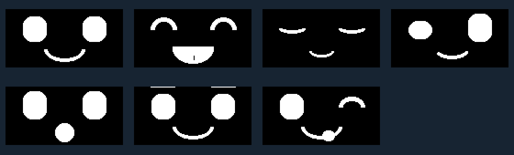

# A little life for our robot dog

Seven cartoon eye-and-mouth animations fit the 128×64 OLED. No nose, words, or heart eyes. This preview uses the same frames as the firmware, enlarged:

| Monitor command | Four-second routine |
|---|---|
| `awake` | Look left and right, then blink |
| `happy` | Happy eye arches and a gently panting tongue |
| `sleep` | Slowly drooping lids and a breathing smile |
| `curious` | Uneven eyes look around, up and down, then blink |
| `surprised` | Wide eyes and an open mouth, then a double blink |
| `cool` | Sunglasses slide down, pause, then lift |
| `cheeky` | Winking eye, a blink and a playful panting tongue |
| `clear` | Blank screen; animation off |

Type one command, then Enter. Named animations repeat for **60 seconds**, then freeze. `stop` freezes the current frame immediately after the current bus operation finishes; it also stops readings and requests motor pulses off. Screen commands never start a motor. In Integration, stop a running motor sequence before selecting a face manually.

In **Display**, `test` is a one-minute parade: each face gets its full four-second routine before the next face. In **Integration**, `test` is still motor preparation; the separately prepared `run` shows these animations with the existing bounded movement and Sleep for the final four seconds. No servo travel or motor timings were changed.

To watch sensor data while a face animates, use Integration: type `start`, then `curious` (or another face). The aligned sensor rows continue at their scheduled 100ms interval. Changing a face cancels the automatic face parade but does not cancel an existing readings stream. `read` is a snapshot; `status` names the selected face and reports whether animation is on or paused. At startup the face is still until you request animation. `cool` replaces `love`.

## How the animation works

A flipbook changes pictures quickly enough to suggest movement. Ours has 40 frames per four-second loop, scheduled every 100ms. The code checks elapsed time instead of waiting in a delay, giving commands, sensor samples and motor deadlines a turn between frames. OLED transfers still take time; timing is scheduled, not a measured real-time guarantee. If a frame is late, the next current frame is shown rather than replaying a backlog. These expressions are scripted, not sensor-driven emotions.

The top-left pixel is (0,0); X grows right and Y grows down. Eyes fill the upper area and mouths use the lower area. Edit `scripts/build_faces.py`, then run `python scripts/build_faces.py` using the documented Python dependencies. It generates the Arduino frame data, still gallery and animated GIF from the same pixels. Identical frames are stored once: this version uses 81 unique 1,024-byte bitmaps in flash, plus a small sequence table. Only the current display buffer is needed in RAM.

Try predicting the next frame. Which few changed pixels make a blink? Ask a teammate to guess the expression without seeing your command. Check every animation, test `stop` halfway through, and confirm `clear` stays blank. Compilation and the preview do not prove your physical screen works.

The current Display and Integration sketches use these animations. Archived Companion and the book are unchanged.
