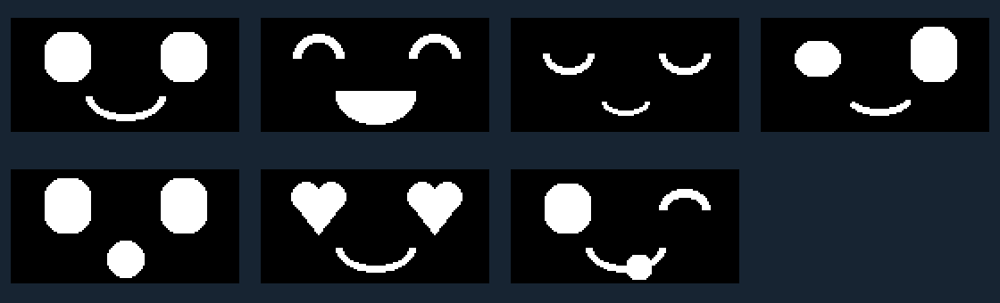

# Seven little faces, big personality

These are the exact 128×64 monochrome pixels used by the current **Display** and **Integration** lessons, enlarged below. Every face uses only cartoon eyes and a mouth, with no nose, eyebrows, labels or extra symbols. No new hardware or wiring is needed.

| Monitor command | What to look for |
|---|---|
| `awake` | Soft solid eyes and a friendly smile |
| `happy` | Arched, laughing eyes and a big grin |
| `sleep` | Closed eyes and a relaxed smile |
| `curious` | One taller eye and an off-center smile |
| `surprised` | Tall eyes and a round open mouth |
| `love` | Heart eyes and a smile |
| `cheeky` | A wink, smile and tongue sticking out |
| `clear` | Blank screen |

Inside the monitor, type one command and press Enter. Commands select faces without starting a servo. During an Integration motor run, use `stop` before selecting a face manually.

In **Display**, `test` runs a one-minute face parade, changing face every two seconds and reporting its name every 100ms. `stop` ends the parade and leaves the current face visible. In **Integration**, `test` remains motor preparation; the separately prepared `run` cycles the seven faces with the existing bounded movement, ending with four seconds of Sleep. Expressions are scripted, not evidence that the robot feels emotions.

## Make it yours

Have one teammate choose a command secretly and ask the other to guess the emotion from the screen. Which mattered more: eyes or mouth? Sketch another expression on a 128×64 grid.

The top-left pixel is (0,0); X grows right, Y grows down. Eyes occupy the upper half and mouths use the lower half, right down to Y=61. No space is reserved for text. Edit the named drawing in `scripts/build_faces.py`, then run `python scripts/build_faces.py` using the repository's documented Python dependencies. This creates both `FaceArt.h` and this preview from the same pixels. Build and upload the relevant lesson using its normal instructions. Each image uses 1,024 flash bytes; seven use 7,168 bytes and are stored in program memory.

Current lesson changes do not update archived Companion expressions. Book updates are deferred to the final pass.
