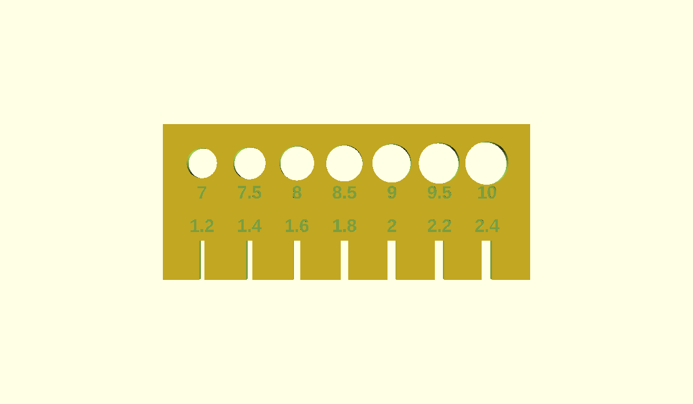

# Measure the servo horn without calipers

The first Leg V1 print did not fit: the horn's raised hub hit the flat pocket floor. Before redesigning, measure the real horn two ways.

## 1. Paper grid photos (lengths, widths, hole spacing)

1. Print [horn-measuring-sheet.pdf](horn-measuring-sheet.pdf) at **100% / Actual size**. Measure the 100 mm bar with a ruler. If it is not 100 mm, fix the print setting and print again.
2. **Box A:** lay the double-arm horn flat, hub facing up, with its long direction along the long grid lines.
3. **Box B:** stand the horn on its edge (a small piece of tape or putty helps) so you see it from the side.
4. Hold the phone straight above each box, about 25 cm away, no zoom, in bright light. All four black squares must be in the photo.
5. Send both photos. The squares are exact reference points, so the photo can be measured to about 0.2 mm.

## 2. Printed fit gauge (hub size and arm thickness)

Print [horn-gauge.stl](../../cad/stl/horn-gauge.stl) flat: 85 x 36 x 3 mm, PLA, 0.20 mm layers, no supports.

- **Hub holes (top row, 7 to 10 mm):** find the smallest hole the round hub drops into without pushing.
- **Arm slots (front edge, 1.2 to 2.4 mm):** find the thinnest slot the flat part of the arm slides into without pushing.

Write down both numbers. Because these are printed on your own printer, they show what will fit in the next printed leg, which is what matters.

**Andrew's job:** predict the hub hole number before trying. Was the guess too big or too small?

Reproduce: `openscad -o cad/stl/horn-gauge.stl cad/horn-gauge.scad` and `python scripts/build_measuring_sheet.py` (needs `reportlab`).
