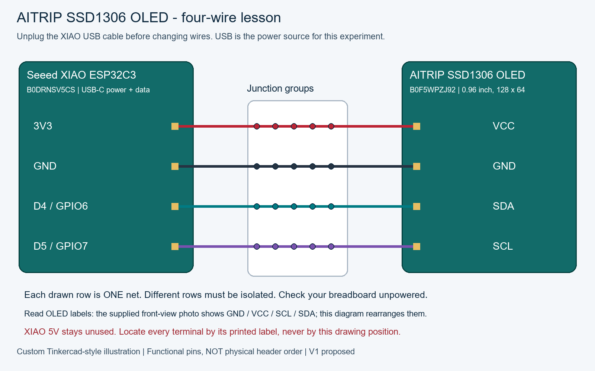
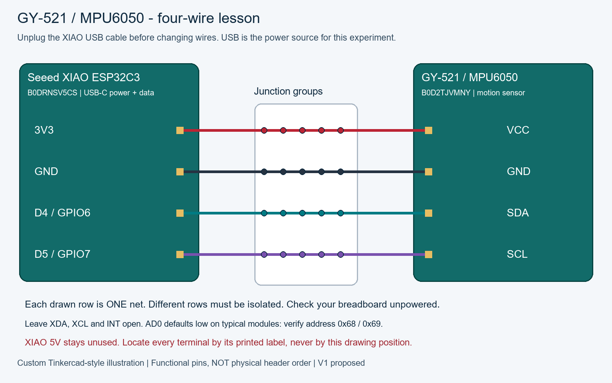
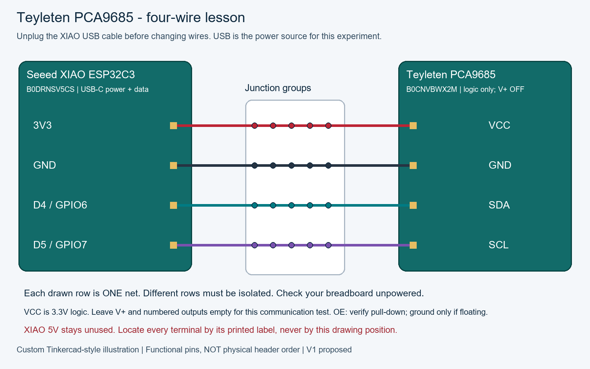
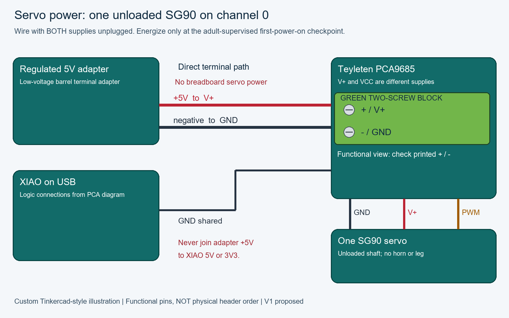
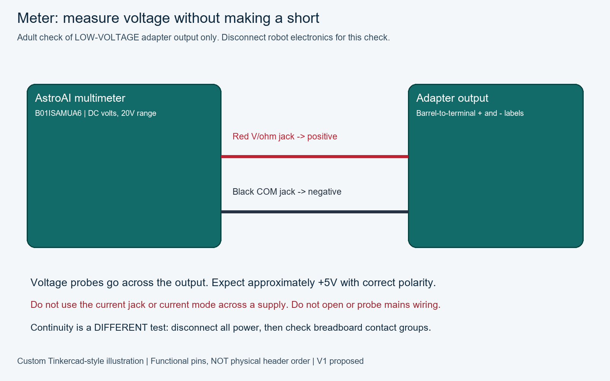

# Wiring atlas: read the labels, trace the wire

These diagrams document the proposed solder-free corded V1. They have not been physically tested. They are custom Tinkercad-style educational illustrations, **not an Autodesk Tinkercad circuit, screenshot or simulation**. They identify the specific purchased models but do not claim photorealistic or verified clone geometry.

## How to use a diagram

1. Find the exact module model and printed pin labels on your part.
2. Read the table and trace one labelled wire at a time. Colors are suggestions, not proof of function.
3. The illustrated breadboard rows mean isolated electrical junctions, not hole-by-hole placement. Check your actual board's contact groups with continuity while unpowered.
4. For integration, the OLED, IMU and PCA share the same four logic nets. Join like-labelled endpoints; never join different nets. Add and test one module at a time.
5. Check against the wiring specification and first-power-on sequence before applying power.

## XIAO ESP32C3 functional pinout

This table is a signal-name lookup, not a physical top/bottom view. USB orientation and clone header geometry must be checked against the manufacturer diagram and actual silkscreen.

| Board label | ESP32 GPIO / role | V1 use |
|---|---|---|
| D0 | GPIO2 | unused |
| D1 | GPIO3 | unused |
| D2 | GPIO4 | unused |
| D3 | GPIO5 | unused |
| D4 | GPIO6 / SDA | I2C data |
| D5 | GPIO7 / SCL | I2C clock |
| D6 | GPIO21 / TX | unused |
| D7 | GPIO20 / RX | unused |
| D8 | GPIO8 | unused |
| D9 | GPIO9 | unused |
| D10 | GPIO10 | unused |
| 3V3 | regulated logic supply | module VCC |
| GND | ground | shared reference |
| 5V | USB-related supply rail | **leave unconnected** |
| USB-C | USB power and data | computer data cable |

Battery pads and the JLJLUP JST1.25 battery are intentionally outside this V1 connection plan. There is no approved battery hookup here.

## Sources and verification limits

- [Seeed XIAO ESP32C3 pin definitions](https://wiki.seeedstudio.com/XIAO_ESP32C3_Getting_Started/).
- [Adafruit PCA9685 power and signal roles](https://learn.adafruit.com/16-channel-pwm-servo-driver/pinouts): reference circuit, not proof of Teyleten clone layout.
- AITRIP OLED header order comes from the owner's product photo; verify the received part matches.
- GY-521 and Teyleten physical header positions, terminal orientation and breadboard contact groups still require inspection of the delivered hardware. No hole-coordinate placement diagram is approved yet.

## Rebuild

From the repository root, install `requirements-book.txt`, then run `python scripts/build_wiring.py`. This regenerates PNGs, connection tables and marked documentation sections from this script. Run `python docs/book/build_book.py` afterwards to update HTML and EPUB. Do not hand-edit marked sections.

<!-- wiring:start -->
**Parts for this power checkpoint:** a regulated 5V wall supply, its low-voltage connector and prepared wires, and a multimeter. For the motor connection, also identify the SG90 servo and PCA9685 driver. The supply powers the motor through the driver; the meter checks its output before connection. Identify these parts before following the diagram.

### Wiring visuals and pinouts

**Before assembling these connections: close the monitor and unplug the XIAO USB cable. Keep the newly introduced 5V supply unplugged from the wall until the voltage-check step. On a repeat session, unplug it before changing wires.** These are functional illustrations: locate terminals by their printed labels. Board shapes do not establish physical pin positions.

The pinout for this stage is USB-C socket only: **all XIAO header pins are unused**.

| From / pin | To / pin | Meaning |
|---|---|---|
| Computer USB port | XIAO USB-C socket | Data cable; all headers empty |

Functional pinout: VCC, GND, SDA, SCL. The supplied display photo has **GND / VCC / SCL / SDA** across its top header when viewed from the front. Our illustration groups wires by function, not that physical order.

| From / pin | To / pin | Meaning |
|---|---|---|
| XIAO 3V3 | AITRIP SSD1306 OLED VCC | 3.3V logic |
| XIAO GND | AITRIP SSD1306 OLED GND | Shared ground |
| XIAO D4 / GPIO6 | AITRIP SSD1306 OLED SDA | I2C data |
| XIAO D5 / GPIO7 | AITRIP SSD1306 OLED SCL | I2C clock |

Functional pinout: VCC, GND, SCL, SDA, XDA, XCL, AD0, INT. Leave XDA/XCL/INT open; verify AD0 default through scanning. Exact delivered header order is unconfirmed. Check regulator/pull-ups at 3.3V; do not substitute 5V to fix detection.

| From / pin | To / pin | Meaning |
|---|---|---|
| XIAO 3V3 | GY-521 / MPU6050 VCC | 3.3V logic |
| XIAO GND | GY-521 / MPU6050 GND | Shared ground |
| XIAO D4 / GPIO6 | GY-521 / MPU6050 SDA | I2C data |
| XIAO D5 / GPIO7 | GY-521 / MPU6050 SCL | I2C clock |

Functional pinout: VCC = logic 3.3V; V+ = separate output-power input; GND = common ground; SDA/SCL = I2C; OE = active-low output enable. Exact clone header order is unconfirmed. Verify OE pull-down; ground OE only if floating. Use only VCC, GND, SDA and SCL for this communication test. Leave V+ and the numbered output connectors empty.

| From / pin | To / pin | Meaning |
|---|---|---|
| XIAO 3V3 | Teyleten PCA9685 VCC | 3.3V logic |
| XIAO GND | Teyleten PCA9685 GND | Shared ground |
| XIAO D4 / GPIO6 | Teyleten PCA9685 SDA | I2C data |
| XIAO D5 / GPIO7 | Teyleten PCA9685 SCL | I2C clock |

Functional servo pinout: ground, power, signal. Read the driver row labels before inserting the plug. **Also complete the PCA logic diagram** (3V3/VCC, GND, SDA, SCL). Use only channel 0 for this experiment. USB and adapter grounds meet at PCA GND; adapter positive never meets XIAO 5V or 3V3. Grounded OE is not a reset interlock: unplug servo power for uploads, resets and horn fitting.

| From / pin | To / pin | Meaning |
|---|---|---|
| Adapter positive | PCA V+ screw terminal | Regulated 5V; direct power wire |
| Adapter negative | PCA GND screw terminal | Direct power wire |
| XIAO GND | PCA GND | Common reference |
| PCA channel 0 GND | SG90 ground | Usually brown/black; verify |
| PCA channel 0 V+ | SG90 power | Usually red; verify |
| PCA channel 0 PWM | SG90 signal | Usually orange/yellow; verify |

Probe-jack pinout is functional, not the physical socket position of every meter variant. Select DC voltage before probing. Verify barrel size and polarity against the actual adapter; do not assume center-positive from a generic picture.

| From / pin | To / pin | Meaning |
|---|---|---|
| Black probe / COM jack | Adapter negative output | Voltage check only |
| Red probe / V-ohm jack | Adapter positive output | DC volts; never current mode |

<!-- wiring:end -->
