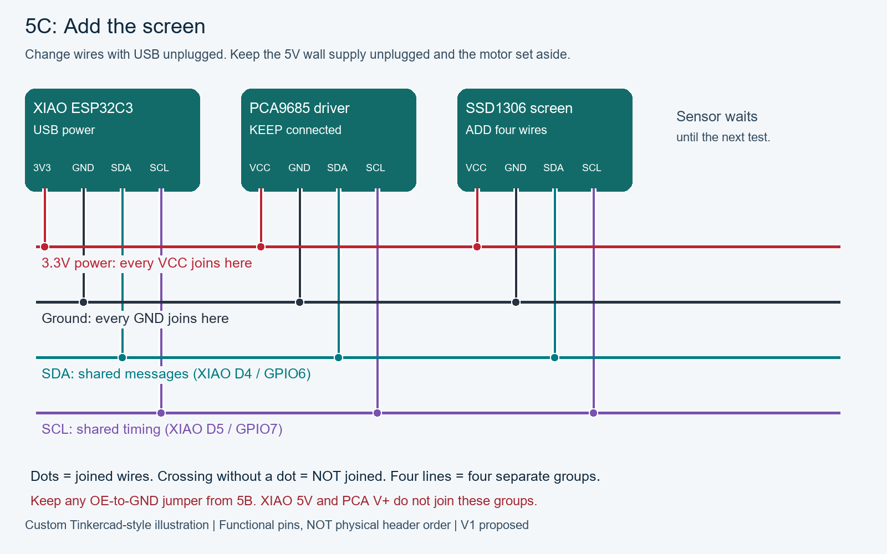
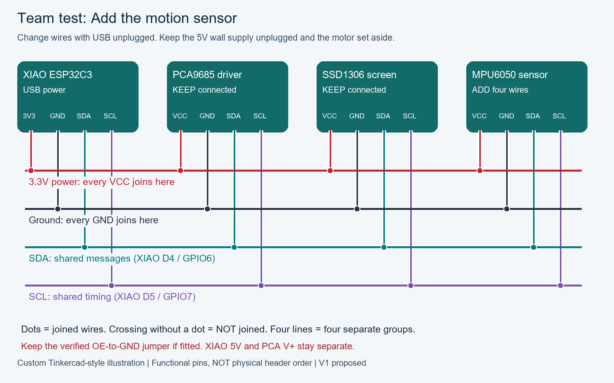

# 07. The team test

**Program:** `Integration` · **Time:** 20–30 minutes · **Partners:** learner operates and explains; adult checks connections and power. Swap the observer/operator roles after the first experiment.

## 1. Mission and success

Combine individually tested functions while identifying which observation proves each one works. Success requires the observations below, not just compilation or `[OK]`.

## 2. Starting setup

All five standalone function checks should have an observation record. With USB and motor supply unplugged, remove the motor plug and keep the driver logic. Add the OLED using the first diagram; power USB and scan to verify 0x40 plus 0x3C/0x3D. Close the monitor and unplug USB, then add the GY-521 using the second diagram. Reconnect USB. Share four separate breadboard groups, never join different groups. No motor power during these additions.

## 3. Wiring and pinout

These custom functional illustrations identify the purchased hardware. They are not exact hole-placement diagrams or Tinkercad simulations. Read printed labels; colors are suggestions. Change wiring only with power unplugged.



Models: Seeed XIAO ESP32C3, Teyleten PCA9685, AITRIP SSD1306 OLED. Read the printed pin labels on each board. Each colored line means one connected breadboard group, not a physical row or rail. The picture rearranges pins to make the four connections easy to follow; it is not a top-view placement guide. Colors are suggestions. Use the XIAO D4 pin for SDA and D5 for SCL.

| From / pin | To / pin | Meaning |
|---|---|---|
| 3V3 | PCA + OLED VCC | Power for the electronics |
| GND | PCA + OLED GND | Shared ground |
| D4 / GPIO6 | PCA + OLED SDA | Messages |
| D5 / GPIO7 | PCA + OLED SCL | Timing |



Models: Seeed XIAO ESP32C3, Teyleten PCA9685, AITRIP SSD1306 OLED, and GY-521 / MPU6050. Read the printed pin labels on each board. Each colored line means one connected breadboard group, not a physical row or rail. The picture rearranges pins to make the four connections easy to follow; it is not a top-view placement guide. Colors are suggestions. Use the XIAO D4 pin for SDA and D5 for SCL.

| From / pin | To / pin | Meaning |
|---|---|---|
| 3V3 | PCA + OLED + GY-521 VCC | Power for the electronics |
| GND | PCA + OLED + GY-521 GND | Shared ground |
| D4 / GPIO6 | PCA + OLED + GY-521 SDA | Messages |
| D5 / GPIO7 | PCA + OLED + GY-521 SCL | Timing |


**Identify the green two-screw block on the PCA9685:** its + / V+ terminal accepts the regulated 5V supply positive wire; its - / GND terminal accepts the negative wire. They are not both V+. This block is not VCC, and it is different from the separate barrel-to-terminal connector on the supply cable. Confirm the actual board markings with power unplugged; the illustration does not establish left/right orientation. Functional servo pinout: ground, power, signal. Read the driver row labels before inserting the plug. **Keep all four XIAO logic wires connected**, as shown in this complete diagram: 3V3/VCC, GND/GND, D4/SDA and D5/SCL. The shared-ground wire is one of these four wires, not an extra fifth wire. Channel 0 is the three-pin output group beside the printed 0 among groups 0 through 15. One plug spans GND, V+ and signal within that group, not three neighboring channel numbers. The green block is not channel 0. Verify actual markings; left/right orientation is not established by this diagram. Use only channel 0 for this experiment. USB and adapter grounds meet at PCA GND; adapter positive never meets XIAO 5V or 3V3. Grounded OE is not a reset interlock: unplug servo power for uploads, resets and horn fitting.

| From / pin | To / pin | Meaning |
|---|---|---|
| Adapter positive | PCA green block: + / V+ | Regulated 5V; direct power wire |
| Adapter negative | PCA green block: - / GND | Direct power wire |
| XIAO 3V3 | PCA VCC | Logic power, separate from V+ |
| XIAO GND | PCA GND | Common reference |
| XIAO D4 / GPIO6 | PCA SDA | I2C data |
| XIAO D5 / GPIO7 | PCA SCL | I2C clock |
| PCA channel 0 GND | SG90 ground | Usually brown/black; verify |
| PCA channel 0 V+ | SG90 power | Usually red; verify |
| PCA channel 0 PWM | SG90 signal | Usually orange/yellow; verify |

## 4. Predict before you run

Will all three addresses remain when the last board joins the circuit? Write one prediction before pressing Enter. Discuss what would count as evidence against it.

## 5. Upload from PowerShell

Close any monitor with Ctrl+C. Keep the 5V motor supply unplugged throughout upload and monitor opening. From the repository root, run ports and identify the XIAO. COM5 is an example, not automatic selection. Replace it in both commands if different.

```powershell
.\robot.ps1 ports
.\robot.ps1 upload -Sketch Integration -Port COM5 -ServoPowerDisconnected
.\robot.ps1 monitor -Port COM5 -ServoPowerDisconnected
```

Run each line separately. Upload replaces the previous program. This lesson does not require Companion. The shared repository library is included automatically by robot.ps1.

## 6. Commands inside the monitor

After `Connecting to COM...`, stay in that terminal. You are now talking to the board, not PowerShell. Type **one command and press Enter** each time. Nothing streams or moves automatically at startup. If you missed the greeting, `help` repeats it.

```text
help
status
scan
read
```

`start` repeats readings every 100 milliseconds for one minute, then ends automatically; `stop` ends them early. `scan` also stops tests. `test` prints motor preparation without moving; `run` is the separate physical start after the adult check. Do not paste preparation and movement commands together. Unknown commands print help guidance. Ctrl+C closes the monitor; it does not send `stop`.

### Read the columns

All timed runs last **60 seconds** unless stopped or faulted. Rows are scheduled every **100ms (10 per second)**. `read` remains one snapshot. `TIME_MS` is board uptime, so compare consecutive timestamps to see the actual spacing; I2C and serial work can delay a row, and missed rows are not replayed in a burst. `help` repeats the command menu; begin another reading run to print a fresh data header.

AX/AY/AZ are acceleration in m/s²; GX/GY/GZ are rotation rate in degrees per second. TEMP_C is chip temperature. PULSE_US is requested pulse width, not measured shaft position; zero means pulse-off requested. Widen the terminal to at least 80 characters.

Example rows to explain the layout (not recorded test evidence):

```text
   TIME_MS      AX      AY      AZ      GX      GY      GZ  TEMP_C PULSE_US
      1200    0.12   -0.08    9.79    0.10    0.20   -0.10   25.12     1500
```

## 7. Investigate

Type `scan`, `status`, `read`, then `start`. Observe acceleration, rotation rate and chip Celsius together. Tilt and rotate gently, then set the sensor down. Type `stop`. Use `awake`, `happy`, `sleep`, `curious`, `surprised`, `cool`, `cheeky` to recheck the OLED. Only after these pass, close the monitor and unplug USB; restore the single unloaded channel-0 servo using the complete diagram, keeping the 5V supply unplugged. Reconnect USB and reopen the monitor before motor power. Reload the exact `range LOW HIGH` command recorded for this same channel-0 servo in lesson 6 (or repeat calibration if its setup changed). Type `test`, complete the adult check, connect motor power, then type `run`. Observe all seven full faces cycling every four seconds with the same 60-second servo trajectory; the final four seconds show Sleep. After completion unplug motor power, then `status` and `outputs`.

## 8. Evidence and exit ticket

Record all three addresses, each sensor measurement with units, visible expressions, actual servo motion and final output-off flags. Missing devices must prevent run; do not mark an address reply as a full pass. The integrated motion is scripted, not autonomous walking or sensor-controlled movement.

Write: **prediction → command → actual observation → explanation → next question**. Repeat the observation once. Ask your teammate to explain the result in their own words; if either person is unsure, record NOT SURE and repeat or troubleshoot instead of declaring a pass.

## 9. Troubleshoot one change at a time

If an addition fails, unplug USB and motor power before removing only the newest module, then restore the last passing setup. Integration requires all three boards; the individual sketches require only their own hardware.

## 10. Finish and hand off

Unplug motor power, close the monitor, then unplug USB. Keep your five independent results plus the team result. Next use the measurement and fit-gauge guides; no enclosure is assumed complete.

[Preview all seven faces and learn to edit their pixels](../../docs/faces/README.md).

[Course map](../README.md) · [Previous lesson](06-servo.md) · [Source code](../sketches/Integration/Integration.ino)

[Supply voltage/polarity measurement](../../docs/wiring/README.md) · [Motor power background](../../docs/WIRING.md)
